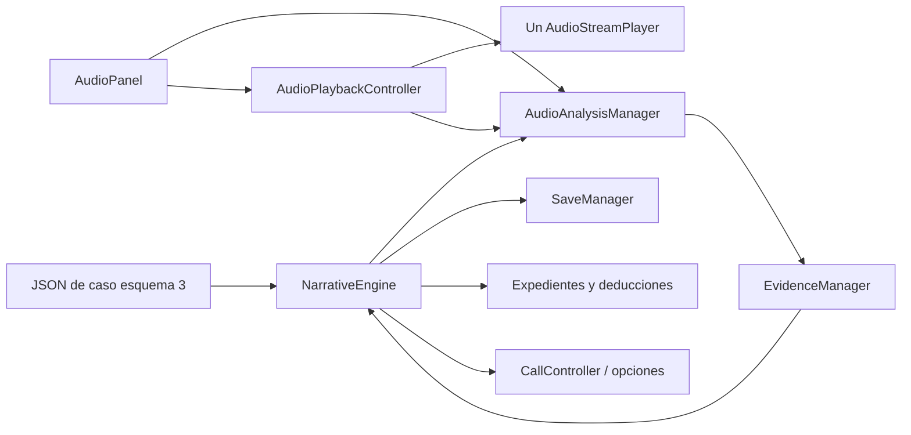

# ÚLTIMA SEÑAL — Analizador de grabaciones

**11R · 2026-10-29:** la campaña consulta G01.S02/Voces mediante acción contextual y Examinar fragmento, sin selectores de filtros TEXT. Reutiliza el mismo manager/reproductor y comprobante consult; abrir no descubre y otros fragmentos siguen disponibles. Audio oficial aún sin recursos; no hay 09B, TTS o síntesis. Transporte/variantes reales de las demos conservados. [Presentación contextual](CASE_FLOW_EXPERIENCE.md).

**Revisión UX posterior a 11:** en el modo TEXT del caso oficial se ocultan transporte, onda/slider y el registro duplicado. Leer fragmento consulta la selección por AudioAnalysisManager, revela su texto y enfoca la lectura completa. Abrir o seleccionar no otorga evidencia. Las variantes/fragmentos siguen disponibles, con rótulos compactos; la demo de audio físico conserva transporte/examen. Recursos oficiales y validación auditiva siguen pendientes. [Revisión](../cases/CASE_001_UX_REVIEW.md).

**Integración 11 · 2026-10-29:** G01/G02 oficiales tienen metadatos y textos aprobados; grabaciones con habla pendientes. Una variante disponible=false/audio_path vacío representa un recurso pendiente explícito, modo TEXT sin stream. No es una ruta inexistente anunciada como reproducible. Los botones permiten seleccionar variante/fragmento y Leer transcripción; consult_selected solo concede la observación si coincide la regla declarada discovery_mode=consult. Umbral cero y comprobante de cero corresponden a consulta, no acreditan escucha. Seleccionar/abrir no registra. Las reglas sin discovery_mode conservan el examen temporal de 09A. capture_information opcional contiene {condition,text}, validado y proyectado solo cuando corresponde; N-4 no aparece antes de N22. [Informe](../cases/CASE_001_IMPLEMENTATION_REPORT.md). No se implementa 09B, TTS o locución; validación auditiva oficial pendiente. El contenido/sistema de reproducción de la demo sigue funcionando.

PROMPT 09A · 2026-10-28 · Godot 4.7.2 estable, Compatibility. Solo grabaciones de investigación; voces durante llamadas y subtítulos sincronizados corresponden a 09B, sin implementar. El Caso 001 oficial conserva su diseño documental.

Actualización de seguimiento 10: el [mapa/despacho técnico](MAP_DISPATCH_SYSTEM.md) comparte la sesión y preserva el analizador. 09B está pospuesto intencionalmente y no bloquea 11. La regresión de sus cuatro suites pasa; solo se ajustó la limpieza final del auxiliar test_audio_playback para liberar el player/mixer antes de terminar, sin cambiar sus once aserciones ni el reproductor de producción.

## 1. Objetivo y acceso

Reproducir grabaciones reales offline, explorar mezclas preparadas/intervalos y registrar observaciones justificadas en la misma investigación de Llamadas y Expedientes. No hay procesamiento espectral, reconocimiento de voz, servicios de síntesis, descargas o nuevas dependencias.

Desde una ejecución nueva: **F5 → Ingresar a la central → Llamadas → Prueba de análisis de audio → Responder comunicación**. Elegir **Habilitar la grabación y registrar el patrón de referencia**. Audio muestra entonces la señal disponible. Si ya hay otra demo activa, volver a ejecutar F5 para elegir esta. Continuar sigue deshabilitado.

Para recuperar después de cerrar: preparar Prueba de análisis de audio y elegir **Recuperar prueba**, sin responder de nuevo. Preparar identifica el contenido y no sobrescribe la partida. Reiniciar prueba elimina explícitamente solo la ranura técnica de audio; nunca la partida oficial.

## 2. Arquitectura



NarrativeEngine continúa siendo la autoridad de estado; EvidenceManager es su fachada de adquisición/consulta. No hay otro inventario de pistas sonoras, otra sesión narrativa o un segundo motor de condiciones. CallController sigue poseyendo motor y guardado. DispatchConsole enlaza Audio y Expedientes a las mismas instancias y vuelve a enlazar al sustituir el controlador.

## 3. Clases y archivos

| Archivo | Responsabilidad |
| --- | --- |
| [audio_catalog_validator.gd](../../scripts/systems/audio_catalog_validator.gd) | Estructura, referencias sonoras, formatos/rutas, recursos, duraciones y límites; condiciones se delegan al validador narrativo |
| [audio_analysis_manager.gd](../../scripts/systems/audio_analysis_manager.gd) | Disponibilidad derivada, proyecciones de jugador, selección autorizada, cualificación desde reproducción y solicitud de registro |
| [audio_playback_controller.gd](../../scripts/systems/audio_playback_controller.gd) | Un Node con AudioStreamPlayer; transporte, mezclas, intervalos, posición, tiempo examinado y errores |
| [audio_panel.gd](../../scripts/ui/audio_panel.gd) | Presentación, controles, mensajes, toque/slider, pausa al ocultar y aviso/reintento del gestor existente |
| [audio_waveform.gd](../../scripts/ui/audio_waveform.gd) | Dibujo de amplitudes precalculadas, intervalo/cursor y solicitud de búsqueda; sin reglas narrativas |
| [audio_panel.tscn](../../scenes/screens/sections/audio_panel.tscn) | Sustituye el placeholder de la sección existente, sin añadir pantalla principal |
| [audio_analysis_demo.json](../../data/audio/audio_analysis_demo.json) | Caso técnico completo con su catálogo de audio, investigación y diálogo de desbloqueo |
| [generate_demo_audio.py](../../tests/audio/generate_demo_audio.py) | Generador reproducible con biblioteca estándar de Python; tres WAV propios y datos de demo |

Todos los scripts tienen UID generado por Godot. No se modifica Main, Theme, iconos, project.godot ni el guion oficial. El reproductor no contiene nombres de evidencias o condiciones; el panel no evalúa reglas ni escribe archivos.

## 4. Formato del catálogo

El **esquema narrativo 3** conserva los campos de 2 y exige `audio_analysis`, dentro del mismo JSON validado/fingerprinted del caso. El archivo de demostración está en data/audio y es un caso técnico completo, no un segundo catálogo desvinculado de su sesión. Los esquemas 1 y 2 y sus ejemplos anteriores siguen admitidos sin cambios.

```json
{
  "audio_analysis": {
    "recordings": [],
    "discovery_rules": []
  }
}
```

Fragmento ilustrativo; el caso completo requiere los demás campos narrativos. Cada grabación exige recording_id, title, description, case_id, unlocked_by, duration, variants y segments; waveform es opcional. ID con patrón `[a-z][a-z0-9_]*`, textos no vacíos, case_id igual al caso cargado y unlocked_by con vocabulario de ConditionEvaluator. Las propiedades desconocidas se rechazan.

Límites: hasta 16 grabaciones, 128 reglas, 64 segmentos por grabación, 256 amplitudes y 120 segundos por archivo de esta versión. Duraciones/tiempos deben ser números finitos, nunca bool o texto. Los catálogos vacíos son válidos y producen estado vacío. El validador no demuestra todas las rutas posibles de condiciones; el motor comprueba las condiciones vigentes al confirmar.

## 5. Variantes y recursos

Cada variante incluye filter_id, label y audio_path; available es opcional y por defecto true. Filtros centrales: original, ambiente y voces. Entre una y tres variantes distintas, con Original declarado. Rutas canónicas res:// y extensiones wav/ogg/mp3, resolubles como AudioStream; no se aceptan rutas del dispositivo, user://, scripts o navegación con .. . Los filtros no ejecutan código ni abren rutas procedentes de la partida.

Faltar un recurso genera advertencia missing_audio_variant y deshabilita esa mezcla con explicación; las otras continúan disponibles. No se sustituye por otro audio, se sintetiza al vuelo o se presenta una variante distinta como si fuera la solicitada. Si ninguna variante sirve, el reproductor informa error y permanece sin reproducción. El reproductor comprueba duración y recurso de nuevo, limita polifonía a uno y desactiva bucles del recurso cargado.

## 6. Sincronización temporal y transporte

Todas las variantes representan el mismo intervalo. Se verifica su longitud real frente a duration, con tolerancia máxima **80 ms**; la demo tiene exactamente 264600 muestras a 22050 Hz por variante, doce segundos. El generador usa los mismos tiempos para todos sus componentes; duración igual por sí sola no demostraría alineación semántica de audios de terceros.

Cambiar filtro conserva la posición dentro de límites y los estados PLAYING/PAUSED; si estaba detenido no inicia audio. El cambio sustituye el stream del mismo player, sin solapamiento. En esta versión hay corte directo entre variantes, sin fundido; no se afirma una transición libre de clics. Cambiar filtro reinicia el cómputo del examen actual, de modo que no hereda escucha de otra mezcla.

Estados físicos: EMPTY, STOPPED, PLAYING, PAUSED, ENDED y ERROR. Reproducir reanuda desde pausa; pulsarlo repetidamente mientras suena es idempotente. Detener vuelve al inicio del modo actual; Repetir vuelve a ese inicio y reproduce. Grabación completa sale del modo segmento y permite recorrer todo el archivo. Seek se limita al modo vigente y reinicia su examen parcial; saltar al final no cuenta como escuchar.

Al abandonar Audio, ocultar la consola/ir al menú o recibir pausa/pérdida de foco de aplicación, se pausa conservando contexto/posición. Volver no reanuda; hace falta Reproducir. Preparar/restaurar/reiniciar otra sesión detiene y limpia el reproductor. No existe coordinación de locuciones de llamadas ni prioridad entre voces; eso queda para 09B.

## 7. Segmentos y onda

Cada segmento exige segment_id, start_time, end_time, title y accessible_information por filtro declarado. Inicio no negativo, anterior al final y final dentro de duration. El ID es único dentro de su grabación. Seleccionar un intervalo reproduce desde su inicio y se detiene en su final, sin tratarlo como final de investigación o final completo. No hace falta posicionar manualmente con precisión de milisegundos.

La onda muestra hasta 256 picos de amplitud precalculados del PCM Original; la demo tiene 120 ventanas de 100 ms. Se identifica expresamente su fuente: no pretende ser una medición en vivo de cada filtro. Resalta el intervalo seleccionado y el cursor temporal; se puede tocar para buscar. No decide descubrimientos. Si no hay amplitudes, la interfaz lo informa y conserva slider/tiempos. No hay FFT, espectrograma o animaciones pesadas.

## 8. Descubrimientos y accesibilidad

Cada regla exige id, recording_id, evidence_id, segment_id, filter_id, min_listen_seconds y once_only: true. additional_conditions es opcional (always) y event_id opcional debe estar declarado. No admite efectos arbitrarios. Todos los ID de reglas son globalmente únicos frente a opciones/consultas/deducciones; tampoco se aceptan dos reglas para la misma combinación grabación/segmento/filtro.

El reproductor mide avance real de su posición de reproducción en fotogramas activos, acotado por el tiempo transcurrido; seek, pausa, saltos grandes y cambio de variante no aportan escucha. No se usa un temporizador que conceda una pista por permanecer en pantalla. AudioAnalysisManager escucha su señal progressed y cualifica la regla solo tras el umbral dentro del modo segmento/filtro requerido. Cambiar pestaña pausa; el examen parcial y la cualificación se mantienen en esa sesión. Repetir un intervalo permite examinarlo de nuevo.

La demo exige tres segundos de un intervalo de cuatro. Abrir el analizador, seleccionar o alternar mezclas no registra nada. Antes de cualificar no se expone la regla/solución como observación lista. El botón Registrar observación envía solo la intención; el jugador no proporciona segundos o un ID de evidencia arbitrario. El manager construye un comprobante canónico después de cumplir el umbral, revalida estado/condiciones y solicita la operación al motor mediante EvidenceManager. Repetir devuelve ALREADY_DISCOVERED sin revisión, eventos o guardado nuevos. Combinación equivocada/insuficiente devuelve INSUFFICIENT, sin penalización.

La información sonora equivalente aparece como texto del intervalo/filtro. Describe los mismos pulsos/tonos y permite interpretar la pista sin audición fina o volumen: se examina durante la misma reproducción, con el mismo umbral y confirmación, sin ventaja lógica o inferencia automática adicional. No son subtítulos sincronizados de personajes. Un driver sin altavoces puede procesar el stream y permitir esa lectura; un archivo ausente no se finge reproducido. El fallback específico de transcripción inmediata del Caso 001 aún no se integra ni se cambia aquí.

## 9. Integración narrativa

NarrativeValidator integra la validación sonora y reutiliza su propio validador de condiciones/referencias, sin otro lenguaje de expresiones. NarrativeEngine ofrece get_audio_catalog para servicios internos y register_audio_observation como puente de confirmación/reconstrucción. El manager filtra todas las consultas de jugador por unlocked_by; no permite leer/cargar/analizar una grabación bloqueada mediante sus API. El motor vuelve a comprobar disponibilidad y condiciones al confirmar.

La operación registra ID y comprobante, deriva add_to_set evidence y el evento opcional declarado y usa la transacción externa de 08. Exige una salida de diálogo elegible, confirma todo o revierte todo. No reentra en nodos, cambia visitas o inventa líneas de conversación. Las condiciones de opciones/deducciones pueden consultar los ID confirmados. Las acciones sonoras no se exponen como consultas directas en Expedientes, evitando eludir el examen del audio.

El Caso 001, en su especificación de 02, concede E03 al iniciar/leer una variante sin esperar al final. El 09A exige examen del intervalo en la demo. Se conserva esa diferencia de alcance explícita: no se reescriben T04/T05, E03 o el guion; la integración oficial futura deberá reconciliar su contrato bajo autorización del usuario.

## 10. Integración con evidencias y deducciones

EvidenceManager.discover_from_audio es el puente interno al motor, equivalente en responsabilidad a discover_from_action. El conjunto único session.evidence recibe los ID de las fichas de investigation.evidence; source conserva procedencia de grabación/intervalo/mezcla. Expedientes se refresca por las señales existentes. DeductionManager no cambia y recibe pistas sonoras del mismo conjunto.

Ejemplo real: aud_unlock entrega aud_reference y desbloquea aud_recording_01. En Audio elegir Ambiente e Intervalo central (00:04–00:08), examinar tres segundos o hasta finalizar y Registrar observación obtiene aud_pulses. En Expedientes, relacionar Referencia del ensayo + Tres pulsos ambientales confirma aud_d01 y habilita cerrar con contraste desde Llamadas. El marcador opcional se obtiene en Voces, intervalo 00:08–00:12. Original + primer intervalo constituye una combinación sin descubrimiento. Todos son datos de prueba fuera de campaña.

## 11. Guardado y restauración

Formato **3** para esquema narrativo **3**; formatos 1/2 conservados para sus esquemas respectivos. Sin migración automática. La envoltura mantiene ocho campos y NarrativeSessionState sus 17 campos. evidence y executed_actions conservan evidencias/reglas/deducciones; las grabaciones desbloqueadas se derivan de variables/condiciones y no se duplican en otra lista.

Las transacciones sonoras añaden solo analysis a la entrada existente `{node_id, choice_id, revision}`:

```json
{
  "recording_id": "aud_recording_01",
  "segment_id": "aud_s02",
  "filter_id": "ambiente",
  "listened_ms": 3000
}
```

choice_id es el ID de regla sonora; analysis contiene cuatro campos exactos, cadenas validadas e integer listened_ms. El manager almacena el umbral canónico cumplido, no tiempos variables por fotograma, para que el mismo recorrido produzca un snapshot idéntico. Solo las entradas de audio admiten analysis en esquema 3. No se guarda PCM, onda, catálogos, posición por frame, segundos parciales o selección de UI.

Al restaurar se verifican tipos/referencias, contexto de grabación/intervalo/filtro/umbral, condiciones, revisión/nodo y efectos mediante la reconstrucción aislada del motor; se intercalan consumos como en 06–08. El puente interno valida comprobantes para esa reproducción determinista; no es un mecanismo contra modificación maliciosa de archivos/código. La UI pública no acepta comprobantes proporcionados por el jugador. Solo si todo coincide se reemplaza memoria, sin nuevas evidencias, eventos o señales de recompensa. La transcripción omite estas acciones externas.

Los exámenes confirmados persisten. Una escucha sin confirmar es exploración temporal y se vuelve a examinar tras cerrar/restaurar; sí se conserva al navegar durante la misma sesión. Restablecer no reanuda audio. Autoguardado, temporal/respaldo, reintento y cotas siguen [SAVE_SYSTEM.md](SAVE_SYSTEM.md), con las observaciones incluidas entre las 2048 operaciones. La demo usa user://audio_analysis_demo, separada de user://saves y de las demos anteriores. Las pruebas solo usan user://save_tests con prefijos únicos.

## 12. API pública

| Componente | API |
| --- | --- |
| AudioAnalysisManager.new(engine, playback) | Se enlaza a la sesión/player reales; catálogo validado obtenido del motor |
| get_recordings() | Proyección solo de desbloqueadas, con título/referencia/duración y número de observaciones confirmadas |
| get_recording(id) | AVAILABLE con segmentos/texto/onda/variantes disponibles, o UNAVAILABLE vacío; omite rutas y reglas internas |
| select_recording(id), set_filter(id), play_segment(id) | Revalidan acceso; no permiten cargar/analisar un recurso bloqueado |
| get_accessible_information() | Texto equivalente del contexto actual o instrucción neutra |
| get_observations(), register_observation(rule_id = "") | Solo listas/confirmadas para el contexto; registro sin tiempos ni IDs de evidencia desde UI |
| dispose() | Pausa y desconecta engine/player/fachada, evitando ciclos de referencias |
| AudioPlaybackController.load_recording(record), clear() | Servicio físico de confianza, recibe solo metadatos previamente validados por aplicación |
| play(), pause(), stop(), replay(), play_full() | Transporte idempotente; ninguna función concede evidencias |
| play_segment(id), set_filter(id), seek(seconds) | Intervalo, variante y búsqueda acotada; conservan reglas de modo/pausa |
| get_view() | Copia: recording_id/filter_id/segment_id/state/position/duration/listened_seconds/error |
| NarrativeEngine.get_audio_catalog() | Copia completa interna de catálogo validado; no usar como proyección de jugador |
| register_audio_observation(id, proof, expected_revision = -1) | Puente interno de servicio/restauración; valida contexto/umbral/condiciones y confirma transacción |
| EvidenceManager.discover_from_audio(id, proof, revision = -1) | Adaptador interno de adquisición, sin otra colección persistente |
| AudioPanel.bind_engine(engine, saves) | Sustituye enlace, detiene reproducción y limpia presentación de la sesión anterior |

Operaciones devuelven `{ok, code, message, data}`. Códigos de manager: AVAILABLE/UNAVAILABLE, INSUFFICIENT, LOCKED, VALID, ALREADY_DISCOVERED; físicos OK/AUDIO_ERROR; motor también STALE/BUSY/INVALID. Señales físicas changed(view), progressed(view), finished(mode), playback_error(report); manager changed sin reglas narrativas en UI. El catálogo está cacheado por sesión; el dibujo por frame usa datos precalculados sin releer recursos.

## 13. Errores

Datos inválidos se rechazan antes de sustituir la sesión. Variantes ausentes se deshabilitan; todas ausentes producen error físico sin corromper investigación. Selección/grabación bloqueada devuelve UNAVAILABLE sin filtrar títulos; segmento/filtro inexistente se rechaza conservando posición/recurso actual. El reproductor no abre rutas externas.

Registro fallido conserva snapshot completo y no publica efectos. Restauración incompatible conserva memoria/originales y usa respaldo compatible conforme a 06. Audio muestra aviso de E/S y reintenta el mismo estado mediante SaveManager, sin volver a otorgar evidencias. Cambiar de grabación detiene la anterior; sustituir sesión desconecta las suscripciones y no conserva cualificaciones ajenas.

## 14. Recursos locales y procedencia

| WAV propio | Contenido sobre la misma línea temporal |
| --- | --- |
| [demo_original.wav](../../assets/audio/demo/demo_original.wav) | Zumbido de 110 Hz, ruido determinista, pulsos y marcador mezclados |
| [demo_ambiente.wav](../../assets/audio/demo/demo_ambiente.wav) | Fondo reducido y tres pulsos de 420 Hz en 4.5/5.2/5.9 s |
| [demo_voces.wav](../../assets/audio/demo/demo_voces.wav) | Fondo tenue y tonos sintéticos de 660/990 Hz en 8.5/9.3 s; no representa habla |

PCM mono, 16 bit, 22050 Hz, doce segundos. Generación estándar math/random/struct/wave con semilla 901, amplitud limitada. No hay grabaciones personales, muestras de terceros, música, licencias externas, voz humana o TTS. Se incluyen sus archivos .import; .godot continúa excluido.

Regeneración opcional, solo con Python local ya disponible:

```powershell
& 'C:\Users\felix\.cache\codex-runtimes\codex-primary-runtime\dependencies\python\python.exe' 'D:\Ultima Señal\tests\audio\generate_demo_audio.py'
```

El generador reconstruye solo sus tres WAV y el caso técnico; no es dependencia de ejecución ni instalación. Después se deben reimportar recursos en Godot. No usarlo para sobrescribir material de producción.

## 15. Pruebas y reproducción

```powershell
$audioGodot = 'D:\Descargas\Exe\Godot_v4.7.2-stable_win64.exe\Godot_v4.7.2-stable_win64_console.exe'
& $audioGodot --headless --path 'D:\Ultima Señal' --import
& $audioGodot --headless --path 'D:\Ultima Señal' --script res://tests/audio/test_audio_catalog.gd
& $audioGodot --headless --path 'D:\Ultima Señal' --script res://tests/audio/test_audio_analysis.gd
& $audioGodot --path 'D:\Ultima Señal' --script res://tests/audio/test_audio_playback.gd
& $audioGodot --headless --path 'D:\Ultima Señal' --script res://tests/audio/test_audio_integration.gd -- 720x1280
& $audioGodot --path 'D:\Ultima Señal' --script res://tests/audio/test_audio_integration.gd -- 720x1280 'D:/Ultima Señal/docs/validation/prompt_09a/720x1280'
```

Repetir integración/bootstrap/navigation en 1080x1920, 1080x2400 y 720x1600, con su directorio correspondiente al capturar. No pedir capturas al renderer headless. La suite lógica inyecta un reproductor simulado y no acredita sonido; la integración usa AudioStreamPlayer real, GUI por mouse/toque, tiempos reales, filtro/seek, fin de segmento/grabación y captura del bus con AudioEffectCapture. Se informa driver, muestras y pico; no se confunde la mezcla de PCM con escucha humana.

Resultados finales: catálogo 70 aserciones, análisis 58, transporte físico 11 y GUI headless 1675/1673 según proporción. GUI gráfica 1736/1734, incluidas 60 comprobaciones de doce capturas y una de salida PCM sobre WASAPI. Diferencia de dos entre proporciones por controles internos de scroll visibles. Las nueve suites anteriores conservan sus fuentes y 4480 aserciones de referencia; total base 6294, sin sumar repeticiones/capturas como nuevos escenarios. Los 20 grupos, comandos de regresión y límites se registran en [PROGRESS.md](../PROGRESS.md).

Captura del bus en las cuatro ejecuciones gráficas finales: WASAPI, dispositivo Default, 96768 fotogramas PCM capturados en tres sondeos por ejecución y pico aproximadamente 0.26855. La prueba física específica verifica cambio de filtro durante PLAYING y PAUSED, avance sin solapamiento, límites de seek y clear. No acredita escucha humana. Headless usa Dummy y también procesa PCM, pero no acredita salida audible del dispositivo.

Doce estados por resolución: empty, locked, available, player, paused, segment, qualified, registered, evidence, restored, optional y ended. **48 PNG reales**, dimensiones verificadas y revisados visualmente. Muestras:

| Estado | 720×1280 | 1080×1920 | 1080×2400 | 720×1600 |
| --- | --- | --- | --- | --- |
| Reproductor | [PNG](../validation/prompt_09a/720x1280/player.png) | [PNG](../validation/prompt_09a/1080x1920/player.png) | [PNG](../validation/prompt_09a/1080x2400/player.png) | [PNG](../validation/prompt_09a/720x1600/player.png) |
| Segmento | [PNG](../validation/prompt_09a/720x1280/segment.png) | [PNG](../validation/prompt_09a/1080x1920/segment.png) | [PNG](../validation/prompt_09a/1080x2400/segment.png) | [PNG](../validation/prompt_09a/720x1600/segment.png) |
| Observación lista | [PNG](../validation/prompt_09a/720x1280/qualified.png) | [PNG](../validation/prompt_09a/1080x1920/qualified.png) | [PNG](../validation/prompt_09a/1080x2400/qualified.png) | [PNG](../validation/prompt_09a/720x1600/qualified.png) |
| Expediente | [PNG](../validation/prompt_09a/720x1280/evidence.png) | [PNG](../validation/prompt_09a/1080x1920/evidence.png) | [PNG](../validation/prompt_09a/1080x2400/evidence.png) | [PNG](../validation/prompt_09a/720x1600/evidence.png) |
| Recuperada | [PNG](../validation/prompt_09a/720x1280/restored.png) | [PNG](../validation/prompt_09a/1080x1920/restored.png) | [PNG](../validation/prompt_09a/1080x2400/restored.png) | [PNG](../validation/prompt_09a/720x1600/restored.png) |

Los controles de transporte/filtro/segmento/registro tienen mínimo 88 unidades lógicas; slider táctil y onda permiten buscar y las listas largas usan el scroll de consola con barra inferior fija. Ninguna cifra o captura se interpreta como prueba de teléfono Android.

## 16. Limitaciones

Validación de escritorio; pendientes APK/release, dispositivo Android, latencia/auriculares reales, gestos físicos, lector de pantalla, zonas seguras y perfil de rendimiento móvil. La comprobación por escucha humana no está acreditada; la captura de bus prueba muestras reales de salida del motor. Cambios entre mezclas son directos; no hay crossfade. La onda pertenece al Original, no es espectro o medición en vivo. No hay editor de segmentos, filtros DSP, reconocimiento de voz o coincidencia automática de sonidos.

Las cualificaciones no confirmadas son temporales; la posición exacta no persiste al cerrar. El estado confirmado sí persiste y no se duplica. Archivo ausente no se presenta como audio escuchado; el texto no constituye un reproductor simulado alternativo que otorgue una pista sin examen. Catálogo y diario tienen límites explícitos y reconstrucción proporcional al historial; rendimiento Android no medido.

El alcance original de 09A no incluye Caso 001, mapa/despacho, pantalla definitiva de resultados, locuciones/subtítulos, TTS/APIs, publicidad, compras, instalaciones o publicación. El mapa se añade posteriormente en 10; 09B sigue pospuesto y no bloquea 11. Ningún trabajo posterior se autoriza por este documento.

## 17. Preparar audio de producción

Cuando se autorice contenido: exportar todas las mezclas desde una misma sesión con mismo inicio/duración, contrastar cada evento/texto con sus segmentos y confirmar niveles/latencia por escucha humana. Usar recursos propios/licenciados, pistas textuales equivalentes, rutas res://, contenido versionado y pruebas de recurso ausente. Revalidar duración y alineación: la tolerancia de 80 ms detecta longitud incompatible, no demuestra identidad temporal del contenido.

Declarar variables de desbloqueo, fichas, reglas únicas con umbrales accesibles y deducciones mediante datos; no editar el motor para incorporar otra grabación. Probar elecciones anteriores/posteriores, pistas opcionales, combinaciones erróneas, navegación, guardado/restauración y errores de E/S en carpetas aisladas. El contrato de audio específico de Caso 001 exige decisión autorizada al integrarse; no se modifica por este documento. Para 09B, reutilizar responsabilidades físicas cuando corresponda, pero definir en su prompt propietario/priority de locuciones y subtítulos. No hay gestor de locuciones adelantado.
