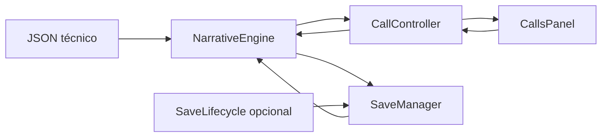

# ÚLTIMA SEÑAL — Llamadas y conversaciones

PROMPT 07 · 2026-10-28 · Godot 4.7.2 estable · demostración de desarrollo.

## Acceso y alcance

Abrir project.godot, ejecutar F5, pulsar **Ingresar a la central**, abrir **Llamadas**, elegir **Iniciar prueba** y después **Responder comunicación**. El rótulo DESARROLLO · PRUEBA FUERA DE CAMPAÑA distingue el contenido técnico. **Recuperar prueba** restaura el checkpoint aislado; **Reiniciar prueba** borra explícitamente solo esa demostración y vuelve a INCOMING.

Las acciones de demostración están condicionadas por OS.is_debug_build(). El menú principal y Continuar no se modifican; Continuar sigue deshabilitado. No hay Caso 001 jugable, llamadas de la campaña, grabaciones, mapa funcional, despacho, deducciones o pantalla definitiva de resultados. No hay sonidos nuevos ni recursos descargados.

## Arquitectura y archivos



| Archivo | Función |
| --- | --- |
| [call_controller.gd](../../scripts/systems/call_controller.gd) | Ciclo visual, comandos, resultados, suscripciones al motor y coordinación de recuperación |
| [calls_panel.gd](../../scripts/ui/calls_panel.gd) | Presentación, controles, scroll y entrada; no evalúa condiciones ni escribe archivos |
| [dialogue_choice.gd](../../scripts/ui/dialogue_choice.gd) | Botón multilínea con ID/revisión estables y selección única por activación |
| [calls_panel.tscn](../../scenes/screens/sections/calls_panel.tscn) | Reutiliza la ruta/instancia de Llamadas existente y sustituye su placeholder |
| [dialogue_entry.tscn](../../scenes/components/calls/dialogue_entry.tscn) | Línea de transcripción numerada, autor, texto y separador |
| [dialogue_choice.tscn](../../scenes/components/calls/dialogue_choice.tscn) | Respuesta reutilizable con Theme heredado |
| [ui_call_demo.json](../../data/cases/ui_call_demo.json) | Caso de prueba no canónico: tres diálogos, transición, dos finales y diez opciones |
| [dispatch_console.tscn](../../scenes/screens/dispatch_console.tscn) | Un ajuste de expansión vertical del contenedor de paneles |
| [dispatch_console.gd](../../scripts/ui/dispatch_console.gd) | Conserva navegación; refleja el estado de llamada en la cabecera común |
| [narrative_engine.gd](../../scripts/narrative/narrative_engine.gd) | Nueva proyección pura get_conversation_history; reutiliza la reconstrucción validada existente |

Main, menú, navegación raíz, Theme y módulos Audio/Mapa/Expedientes permanecen sin cambios de código. La consola mantiene instancias; no se recrea la llamada al cambiar de pestaña ni al volver del menú. Sin autoloads o nuevos propietarios globales. CallsPanel posee un CallController y un adaptador SaveLifecycle hijo; el controlador posee un motor y un gestor de guardado. dispose desconecta suscripciones y desactiva autoguardado al reemplazarlo/cerrar la escena, evitando ciclos de referencias.

## Responsabilidades

NarrativeEngine sigue siendo la única autoridad sobre cursor, condiciones, efectos, variables, evidencias, eventos y finales. SaveManager conserva su algoritmo de archivos sin cambios. CallController mantiene solo estado de presentación derivado y copias de la transcripción, sin reglas de confianza/estrés ni árbol narrativo propio. CallsPanel recibe una vista, construye controles y envía ID/revisión; no utiliza FileAccess, ConditionEvaluator ni EffectProcessor.

Los nombres, intervenciones, respuestas y desenlaces vienen de JSON/API del motor. Etiquetas de sistema como Operador o Central son roles de presentación, no personajes nuevos de la historia. La demostración añade Número desconocido y Operador · prueba como identificadores técnicos; no usa personas, hotel, sucesos o finales del Caso 001. El caso original de 05 se conserva intacto porque no tenía todos los interlocutores/textos de prueba visual requeridos.

## Estados y transiciones

| Estado | Entrada y acciones permitidas |
| --- | --- |
| IDLE | Sin sesión ni comunicación; preparar o recuperar una demo |
| INCOMING | Contenido cargado y llamada pendiente; responder una sola vez; aún no hay efectos, historial o checkpoint de sesión |
| CONNECTED | Sesión iniciada; opciones del motor, consulta de historial y navegación sin avanzar por sí solas |
| ENDED | Nodo ending alcanzado/restaurado; historial conservado y sin decisiones; resultado claramente técnico |
| ERROR | Carga/conexión fallida sin sesión utilizable; acción de desarrollo permite corregir/reintentar |

prepare_call solo prepara desde IDLE o ERROR sin una llamada anterior. No sustituye INCOMING, CONNECTED o ENDED. answer_call requiere INCOMING y construye la sesión mediante start_case. select_choice requiere CONNECTED. restart_demo es una acción explícita de depuración; no equivale a rechazar una llamada con consecuencias. Una restauración válida deriva CONNECTED/ENDED de la sesión y no vuelve a presentar INCOMING.

Un error de elección, guardado o recuperación con sesión válida no cambia su estado narrativo ni la desconecta. ERROR se reserva a ausencia de sesión utilizable. Acciones reentrantes durante operaciones/notificaciones devuelven busy sin modificar datos ni emitir notificaciones recursivas.

## Flujo de una elección

1. El botón captura ID y revisión de la vista del motor, nunca identifica por texto.
2. Se bloquean controles durante el turno de entrada. Doble clic/doble toque clasificado por Godot se ignora también entre fotogramas; no hay temporizadores de avance o espera narrativa.
3. El controlador llama engine.select_choice(id, expected_revision).
4. Solo el motor revalida visibilidad/habilitación, aplica efectos y resuelve transiciones de forma completa.
5. Si rechaza, estado y transcripción se conservan. Se muestra un mensaje apropiado y código técnico de la demostración.
6. Si confirma, el controlador consulta nodo, opciones e historial y publica una vista completa.
7. SaveManager recibe state_changed, agrupa solicitudes y guarda fuera del callback como en 06.

Una reentrada legítima en un diálogo puede repetir su intervención, con otro ID de visita; una actualización de pantalla no añade líneas. Las opciones deshabilitadas incluyen su motivo como texto visible, además del estado del botón; no requieren tooltip. Opciones ocultas nunca se crean. Las revisiones rechazan callbacks obsoletos y controles antiguos se retiran al cambiar las opciones.

## Historial y persistencia de presentación

Se añade **get_conversation_history() -> Array** al motor. Reutiliza la reconstrucción determinista del validador de 06 en una instancia aislada, sin observadores, archivos ni efectos sobre la sesión viva. Devuelve copias de líneas con id, kind, speaker, text, node_id y choice_id cuando corresponde. Los ID son node:<visita> y choice:<revisión previa>.

Se incluyen únicamente nodos estables confirmados que se publicaron para presentación y respuestas realmente elegidas. Las transiciones automáticas, ramas no visitadas, elecciones rechazadas y consumos de eventos no crean mensajes. Los consumos intercalados se reconstruyen con las revisiones del registro existente. No se adivinan diálogos a partir de la evidencia ni se recorren otras ramas.

La aplicación de esta fase solo avanza al responder/elegir en Llamadas. La transcripción representa presentación lógica confirmada; no es un registro de lectura humana ni acredita que cada píxel alcanzó a dibujarse antes de una interrupción del proceso. No se agregan confirmaciones de lectura, variantes futuras o un segundo registro narrativo.

El esquema narrativo y **save_version 1 permanecen sin cambios**. transaction_log, visitas y consumos ya permiten reconstruir las líneas con el contenido exacto validado por fingerprint. El controlador no guarda otra copia de historia en disco. Al cargar se recuperan variables, evidencias, efectos y final mediante SaveManager, se reconstruye la presentación y se muestra el nodo/opciones vigentes. El historial se conserva entre pestañas y entre menú/consola; no hay llamada nueva al volver.

La vista usa controles persistentes para el prefijo inalterado. Actualizaciones idénticas no agregan nodos visuales. El historial y las respuestas tienen ScrollContainer separados; la barra inferior permanece accesible. Si el lector revisa mensajes antiguos, una nueva intervención conserva su desplazamiento. Al cargar un historial nuevo o seguir el final, se muestra el inicio de la intervención reciente después de que los contenedores calculen su tamaño. Leer o desplazar nunca provoca efectos narrativos.

La reconstrucción tiene coste proporcional al historial y usa copias/reproducción de verificación; no se afirma rendimiento constante ni se ha perfilado en Android. Se mantienen los límites explícitos de persistencia de 06. Futuras variantes de texto o conversaciones simultáneas requerirán contratos adicionales autorizados.

## Guardado aislado y ciclo de vida

La demostración usa únicamente **user://call_demo** y los cuatro nombres de slot_01 gestionados por SaveManager. El constructor de CallController rechaza la carpeta de producción u otras ubicaciones; para pruebas acepta subcarpetas canónicas de user://save_tests/. Los datos JSON no eligen la carpeta. Las suites usan directorios únicos por proceso/ejecución, nunca la partida de producción ni la demostración manual.

El autoguardado se activa al responder y tras recuperar una sesión válida. Una carga no vuelve a guardar por sí sola. Si recuperar falla con sesión activa, conserva tanto la conversación como la política anterior de autoguardado. Reiniciar la demo solicita delete_save(true) en su carpeta aislada, desactiva autoguardado y vuelve a INCOMING con historial vacío; responder iniciará otra sesión.

SaveLifecycle queda conectado al mismo gestor cuando CallsPanel existe. Pausa/pérdida de foco/cierre solicitan el vaciado de cambios estables conforme a 06; navegar/ocultar una pestaña no destruye el controlador. No se cambia auto_accept_quit ni se añaden permisos. No se depende de la notificación final de Android ni se promete conservar acciones que no llegaron al checkpoint.

Un fallo de autoguardado muestra que el progreso sigue en memoria y ofrece Reintentar guardado de la prueba; no repite la elección. Sus detalles estructurados quedan en get_view().error y SaveManager.get_last_result y se registran como CALL_DIAGNOSTIC en compilaciones de desarrollo; la demostración muestra el código para diagnóstico, sin estadísticas narrativas permanentes. Al recuperarse del error se conserva la conversación y desaparece el aviso de escritura. Ninguna consulta del panel escribe archivos.

## API y señales

| API de CallController | Resultado |
| --- | --- |
| prepare_call(path = DEMO_PATH) | Carga datos y pasa a INCOMING sin iniciar la sesión |
| answer_call() | Inicia sesión una vez y deriva CONNECTED/ENDED |
| select_choice(id, expected_revision) | Envía decisión al motor; resultado estructurado |
| restore_call(path = DEMO_PATH) | Recupera principal/respaldo mediante SaveManager; conserva una sesión válida ante error |
| restart_demo() | Reinicio explícito de datos y presentación de esta demostración |
| retry_save() | Reintenta persistir el estado existente sin procesar otra decisión |
| get_view() | Copia con estado, interlocutor, case_id, mensaje, historial, opciones, error y ending_id |
| dispose() | Desconexión idempotente del controlador; no borra archivos |

Las operaciones devuelven ok, code, message y data. presentation_changed(view) publica la vista; communication_ended(ending_id) señala el cambio visual a ENDED una vez, sin sustituir case_finished del motor. El controlador escucha node_changed, choices_changed y session_restored, agrupando actualizaciones externas fuera de los callbacks; escucha operation_completed del gestor para informar de errores.

CallsPanel expone configure_development_storage para pruebas aisladas, set_development_enabled para comprobar la política de acceso y call_presentation_changed para la cabecera común. El parámetro opcional de script de guardado es una inyección de pruebas de código confiable para simular fallos, no se lee de JSON. dialogue_choice emite choice_requested(id, revision). No se incorporan escenas duplicadas de consola, nuevos autoloads ni temporizadores.

## Recorridos comprobados

- **Confirmado:** Responder → demo_confirm → demo_ready → demo_finish → demo_complete.
- **Alternativo:** Responder → demo_wait → demo_move → demo_finish → demo_partial.
- **Recuperación de condición:** demo_wait deja la confirmación bloqueada; demo_adjust modifica el estado mediante efectos del motor y habilita demo_ready. La evidencia demo_record se registra una sola vez; demo_checked es una solicitud técnica, sin reproducir audio ni realizar un despacho.

Los identificadores de desenlace se muestran explícitamente como resultado de prueba. No hay puntuación, recompensa ni final oficial nuevo.

## Pruebas y comandos

```powershell
$godotExecutable = 'D:\Descargas\Exe\Godot_v4.7.2-stable_win64.exe\Godot_v4.7.2-stable_win64_console.exe'
& $godotExecutable --headless --path 'D:\Ultima Señal' --import
& $godotExecutable --headless --path 'D:\Ultima Señal' --script res://tests/calls/test_call_controller.gd
& $godotExecutable --headless --path 'D:\Ultima Señal' --script res://tests/calls/test_call_integration.gd -- 720x1280
& $godotExecutable --path 'D:\Ultima Señal' --script res://tests/calls/test_call_integration.gd -- 720x1280 'D:/Ultima Señal/docs/validation/prompt_07/720x1280'
```

Repetir integración con 1080x1920, 1080x2400 y 720x1600, cambiando también la carpeta de captura. Las pruebas envían eventos reales del sistema GUI de Godot: mouse, toque simulado, doble clic/doble toque y navegación; no sustituyen la interacción por emitir pressed. También validan el controlador por API.

| Suite/comprobación | Resultado ejecutado |
| --- | --- |
| test_call_controller | PASS, 68 comprobaciones |
| Integración headless 720×1280 / 1080×1920 | PASS, 402 comprobaciones por ejecución |
| Integración headless 1080×2400 / 720×1600 | PASS, 400 comprobaciones por ejecución |
| Integración gráfica 720×1280 / 1080×1920 | PASS, 452 comprobaciones por ejecución, incluidas capturas |
| Integración gráfica 1080×2400 / 720×1600 | PASS, 450 comprobaciones por ejecución, incluidas capturas |
| Motor anterior | PASS, 151 y 334 comprobaciones |
| Guardado anterior | PASS, 114 y 905 comprobaciones |
| Total principal de referencia | 1974 aserciones: 1504 anteriores + 68 controlador + 402 integración base; no suma otra vez resoluciones/capturas/workers |
| Bootstrap y navegación anteriores | PASS headless en cuatro tamaños; 129 nodos estables antes/después de navegar sin iniciar demo |
| Importación/inicio | Salida 0; arranque normal headless y gráfico sin errores críticos reportados |

La diferencia de dos comprobaciones entre proporciones corresponde a controles internos de scroll que no son visibles cuando sobra altura; no se retiraron aserciones. Los contadores son aserciones, no ese número de escenarios independientes. El detalle de las 18 pruebas solicitadas e incidencias se registra en [PROGRESS.md](../PROGRESS.md).

## Capturas reales

Diez estados por resolución, 40 PNG con dimensiones físicas exactas, revisados visualmente. Las cuatro columnas corresponden a ejecuciones gráficas nuevas de esta fase.

| Estado | 720×1280 | 1080×1920 | 1080×2400 | 720×1600 |
| --- | --- | --- | --- | --- |
| Sin llamada | [Ver](../validation/prompt_07/720x1280/idle.png) | [Ver](../validation/prompt_07/1080x1920/idle.png) | [Ver](../validation/prompt_07/1080x2400/idle.png) | [Ver](../validation/prompt_07/720x1600/idle.png) |
| Entrante | [Ver](../validation/prompt_07/720x1280/incoming.png) | [Ver](../validation/prompt_07/1080x1920/incoming.png) | [Ver](../validation/prompt_07/1080x2400/incoming.png) | [Ver](../validation/prompt_07/720x1600/incoming.png) |
| Conectada | [Ver](../validation/prompt_07/720x1280/connected.png) | [Ver](../validation/prompt_07/1080x1920/connected.png) | [Ver](../validation/prompt_07/1080x2400/connected.png) | [Ver](../validation/prompt_07/720x1600/connected.png) |
| Condición | [Ver](../validation/prompt_07/720x1280/conditional.png) | [Ver](../validation/prompt_07/1080x1920/conditional.png) | [Ver](../validation/prompt_07/1080x2400/conditional.png) | [Ver](../validation/prompt_07/720x1600/conditional.png) |
| Historial | [Ver](../validation/prompt_07/720x1280/history.png) | [Ver](../validation/prompt_07/1080x1920/history.png) | [Ver](../validation/prompt_07/1080x2400/history.png) | [Ver](../validation/prompt_07/720x1600/history.png) |
| Recuperada | [Ver](../validation/prompt_07/720x1280/restored.png) | [Ver](../validation/prompt_07/1080x1920/restored.png) | [Ver](../validation/prompt_07/1080x2400/restored.png) | [Ver](../validation/prompt_07/720x1600/restored.png) |
| Final confirmado | [Ver](../validation/prompt_07/720x1280/ended.png) | [Ver](../validation/prompt_07/1080x1920/ended.png) | [Ver](../validation/prompt_07/1080x2400/ended.png) | [Ver](../validation/prompt_07/720x1600/ended.png) |
| Final alternativo | [Ver](../validation/prompt_07/720x1280/ended_partial.png) | [Ver](../validation/prompt_07/1080x1920/ended_partial.png) | [Ver](../validation/prompt_07/1080x2400/ended_partial.png) | [Ver](../validation/prompt_07/720x1600/ended_partial.png) |
| Fallo de guardado | [Ver](../validation/prompt_07/720x1280/save_error.png) | [Ver](../validation/prompt_07/1080x1920/save_error.png) | [Ver](../validation/prompt_07/1080x2400/save_error.png) | [Ver](../validation/prompt_07/720x1600/save_error.png) |
| Error de contenido | [Ver](../validation/prompt_07/720x1280/load_error.png) | [Ver](../validation/prompt_07/1080x1920/load_error.png) | [Ver](../validation/prompt_07/1080x2400/load_error.png) | [Ver](../validation/prompt_07/720x1600/load_error.png) |

## Limitaciones y preparación posterior

Solo escritorio Windows/Compatibility e interacción táctil simulada. No hay APK, exportación release, teléfono Android real, medición de rendimiento, prueba de lector de pantalla, sonido o gestos físicos del dispositivo. Se comprueba la política de desarrollo desactivándola en pruebas; no se presenta como una exportación release verificada. Persisten las garantías/limitaciones de almacenamiento documentadas en [SAVE_SYSTEM.md](SAVE_SYSTEM.md).

No hay llamada de campaña, árbol del Caso 001, combinación de evidencias, audio, mapa, despacho, múltiples comunicaciones simultáneas o resultados oficiales. El espacio de demostración conserva un checkpoint entre ejecuciones hasta reinicio explícito. Una actualización incompatible de sus datos puede exigir Reiniciar prueba para reemplazar ese checkpoint; nunca se elimina automáticamente al fallar la carga.

El panel y el controlador pueden presentar otros casos mediante sus API y datos, pero esos casos, su validación de dominio y su conexión al flujo de producción requieren autorización. **PROMPT 07 termina aquí. PROMPT 08 no autorizado.**
