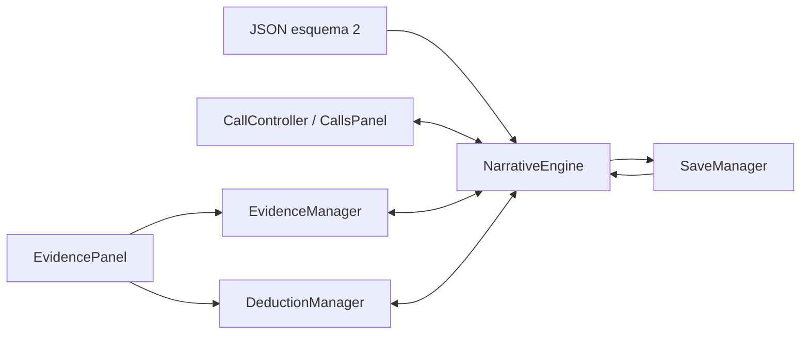

# ÚLTIMA SEÑAL — Evidencias, expedientes y deducciones

**11R · 2026-10-29:** DeductionManager.get_reasoning/reason añade interpretación contextual a c001: fuentes descubiertas pertinentes, pregunta y respuestas sin indicador de corrección en la proyección. El servicio exige las fuentes declaradas y confirma por la API existente; error sin efectos, revisión obsoleta rechazada e idempotencia conservada. Q01 guiada; Q02 influye en A, Q03/Q04 opcionales. El archivo prioriza fuentes pertinentes y permite expediente completo. La selección libre anterior sigue en paneles/demos. [Contrato](CASE_FLOW_EXPERIENCE.md).

**Revisión UX posterior a 11:** el perfil oficial muestra un selector de hipótesis; selección/hipótesis activa y Comprobar relación permanecen en una barra fija de la consola. Confirmar conserva el feedback, enfoca su explicación y limpia solo la selección temporal. Las combinaciones siguen siendo exactas y no se sugieren fuentes correctas. La navegación conserva lectura, con Retomar llamada directo y aviso de respuesta nueva cuando corresponde. Las demos y DeductionManager conservan sus reglas. [Revisión](../cases/CASE_001_UX_REVIEW.md).

**Integración 11 · 2026-10-29:** diez fichas/cuatro deducciones oficiales en [Caso 001](../cases/CASE_001_IMPLEMENTATION_REPORT.md). DeductionManager.get_hypotheses proyecta ID/título sin fuentes faltantes; relate_hypothesis comprueba intención y conjunto exacto, con respuesta neutral a subconjunto/extra. EvidencePanel habilita modo hipótesis y selección de hasta tres cuando el catálogo tiene reglas de tres fuentes; las demos de dos mantienen su UI. internal=true oculta acciones técnicas de conexión del expediente. Evidencia/conclusiones siguen en evidence/executed_actions, sin nuevas colecciones. is_investigation_closed bloquea adquisición desde K02, manteniendo consulta del archivo. Los apartados originales de 08 siguientes conservan su alcance histórico, incluido el anterior límite de dos de la UI.

PROMPT 08 · 2026-10-28 · Godot 4.7.2 estable · Windows/Compatibility. Implementación genérica y demostración fuera de campaña. El Caso 001 oficial no está integrado. Decisiones D-043–D-048 en [DECISIONS.md](../DECISIONS.md).

Ampliación 09A: [AUDIO_ANALYZER.md](AUDIO_ANALYZER.md) conecta observaciones de grabaciones al mismo EvidenceManager/estado. Añade discover_from_audio como puente interno al motor, esquema/guardado 3 con comprobante mínimo y otra demo aislada; los contratos/resultados originales de 08 descritos abajo se conservan para esquema/formato 2.

Ampliación 10: [MAP_DISPATCH_SYSTEM.md](MAP_DISPATCH_SYSTEM.md) conecta partes operativos por el puente estático EvidenceManager.process_dispatch_event(engine, command, revision). El motor confirma estado de unidad/incidente y efectos/evidencia juntos; ningún inventario paralelo o adquisición por abrir el mapa. Fichas declaradas en investigation.evidence, registro común y consulta en Expedientes. Formato/esquema 4 conserva los anteriores y no cambia DeductionManager. 09B pospuesto no bloquea 11; Caso 001 no integrado.

## 1. Arquitectura

Una sola sesión de NarrativeEngine es la autoridad. EvidenceManager y DeductionManager son fachadas RefCounted; no mantienen otra copia persistente del progreso. EvidencePanel presenta sus proyecciones dentro de la sección Expedientes existente. CallController sigue poseyendo motor y SaveManager; DispatchConsole conecta ambos paneles a esas mismas instancias.



## 2. Responsabilidades y archivos

| Archivo | Responsabilidad |
| --- | --- |
| [evidence_manager.gd](../../scripts/systems/evidence_manager.gd) | Categorías centrales, fichas descubiertas ordenadas, detalles, proyección sin metadatos de solución, acciones autorizadas y señal de nuevo descubrimiento |
| [deduction_manager.gd](../../scripts/systems/deduction_manager.gd) | Evaluación pura de combinaciones, resultados, solicitud de confirmación al motor y conclusiones confirmadas en orden de descubrimiento |
| [narrative_validator.gd](../../scripts/narrative/narrative_validator.gd) | Esquema 1/2, fichas, reglas, condiciones, efectos y referencias |
| [narrative_engine.gd](../../scripts/narrative/narrative_engine.gd) | Confirmación atómica, revisión, señales, registro y reconstrucción de acciones externas |
| [narrative_state_validator.gd](../../scripts/narrative/narrative_state_validator.gd) | Snapshot de la versión del caso cargado; tipos y límites existentes |
| [save_manager.gd](../../scripts/systems/save_manager.gd) | Selección del formato 1 o 2 y persistencia/recuperación verificadas |
| [evidence_panel.gd](../../scripts/ui/evidence_panel.gd) | Lista, filtro, selección, detalle, conclusiones, acciones y aviso/reintento de guardado |
| [dispatch_console.gd](../../scripts/ui/dispatch_console.gd) | Enlace de Expedientes al controlador real y sustituciones explícitas de demo |
| [calls_panel.gd](../../scripts/ui/calls_panel.gd) | Acceso de desarrollo a la nueva demostración; conserva selección de caso/ruta para recuperar |
| [investigation_demo.json](../../data/cases/investigation_demo.json) | Cinco evidencias, dos deducciones, dos consultas, cinco nodos y ocho opciones de diálogo |

No hay autoload nuevo, dependencia externa, catálogo duplicado en UI ni escritura de partidas desde el panel.

## 3. Catálogo de datos

El esquema narrativo **2** conserva todos los campos del esquema 1 y exige `investigation: {evidence: [], deductions: [], actions: []}`. Los tres arrays pueden estar vacíos. Esquema 1 sigue aceptado con su contrato original y sin ese campo. `content_version` es independiente; la demo usa `investigation-1.0`. Propiedades desconocidas se rechazan.

Cada ID de `evidence_catalog` exige exactamente una ficha en `investigation.evidence`:

| Campo | Contrato |
| --- | --- |
| id | ID declarado y único; patrón `[a-z][a-z0-9_]*` |
| title, description, source | Textos no vacíos; descripción completa y procedencia legibles |
| category | Uno de los cinco ID centrales indicados abajo |
| importance | `essential`, `optional` o `contextual`; metadato de autoría, nunca mostrado por la proyección del jugador |
| related_asset | Opcional; texto vacío o imagen canónica `res://` png/jpg/jpeg/webp/svg |
| order | Opcional; entero no negativo, por defecto 0; empate ordenado por ID |

| ID de categoría | Etiqueta |
| --- | --- |
| testimony | Testimonios |
| document | Documentos |
| record | Registros |
| audio | Audio |
| anomaly | Anomalías |

Los cinco nombres proceden de EvidenceManager.CATEGORIES, compartido con el validador. Clasificar una ficha como Audio no incorpora reproducción. Una imagen ausente genera advertencia `missing_optional_asset` y se usa texto; rutas de scripts, user://, navegación o rutas absolutas se rechazan. La demo reutiliza el icono propio `assets/ui/icons/evidence.svg` como ilustración técnica opcional.

## 4. Estados de las evidencias

El conjunto `session.evidence` existente contiene los ID descubiertos, sin duplicados. No se persiste un objeto por ficha ni un segundo estado de descubrimiento. Antes del descubrimiento, `get_detail` devuelve UNAVAILABLE con data vacío, igual para ID oculto o inexistente. Solo fichas descubiertas aparecen en lista, categorías o detalle; la cabecera cuenta lo descubierto, sin revelar un total oculto. Las acciones aún condicionadas tampoco exponen títulos.

El catálogo completo de `get_investigation_catalog` es una copia para servicios internos, no una proyección de jugador. La interfaz obtiene fichas de EvidenceManager, no recorre ese catálogo para mostrar pistas futuras. Los casos antiguos de esquema 1 conservan su evidencia interna pero no inventan fichas: la sección informa que no hay expediente consultable.

## 5. Descubrimiento

Una elección o entrada narrativa utiliza el efecto existente:

```json
{"op": "add_to_set", "target": "evidence", "value": "inv_e01"}
```

Otra ruta autorizada declara una acción en `investigation.actions` con `id`, `title`, `effects` obligatorios y `condition` opcional (always por defecto). El panel solicita `discover_from_action(id, revision)`; el motor valida la condición actual y ejecuta los efectos. No se acepta una ficha, efecto o variable arbitraria desde UI. Una acción solo se confirma una vez; el motor rechaza nuevas adquisiciones tras el final.

`evidence_registered(id)` solo se publica si el conjunto cambia. EvidenceManager la reenvía como `evidence_discovered(id)`; consultar o volver a adquirir la misma pista no genera un descubrimiento nuevo. La demo concede tres fichas por diálogo y otras dos por consultas del expediente habilitadas al descubrir el registro.

## 6. Reglas de deducción

Una regla requiere `id`, `title`, `description`, `required_evidence`, `result_type: "VALID"`, `effects` y `narrative_feedback`. `additional_conditions` es opcional, always por defecto. `repeatable` es opcional con valor por defecto false; true se rechaza. No hay reglas con castigos por combinación equivocada.

`required_evidence` admite dos o tres ID distintos declarados. La comparación es de conjunto exacto, sin importar orden; un subconjunto o superconjunto no activa una regla. Dos reglas para el mismo conjunto se rechazan como ambiguas, incluso si declaran distintas condiciones. Opciones de diálogo, acciones de investigación y deducciones comparten un espacio global de ID únicos para que su registro sea inequívoco.

La interfaz permite seleccionar **dos** evidencias; el servicio admite tres para autoría futura sin rehacer su lógica. Esto no crea un selector de tres en esta fase. La evaluación comprueba primero que los ID sean distintos, existentes y descubiertos; después combina y revisa condiciones actuales. Ninguna regla se confirma por abrir un detalle o pedir preview.

## 7. Resultados

Todos usan `{ok, code, message, data}`; data es copia independiente.

| code | Significado y efectos |
| --- | --- |
| VALID | Preview: relación evaluable y `confirmed: false`, sin mutar. Relate: confirmación exitosa y `confirmed: true` |
| ALREADY_DISCOVERED | Conclusión conocida, consultable incluso tras el final; sin nueva revisión, señal, recompensa o escritura |
| INSUFFICIENT | Selección de tamaño no admitido o conjunto sin regla; retroalimentación neutral, sin penalización |
| LOCKED | Regla coincidente con condición adicional pendiente o expediente cerrado; sin revelar título/solución bloqueada |
| INVALID | ID repetido, desconocido o no descubierto, falta de sesión, acción desconocida o candidato sin opciones válidas; sesión intacta |
| STALE | Revisión obsoleta al intentar confirmar una operación nueva; sesión intacta |
| BUSY | Mutación reentrante durante otra operación/notificación; sin cambios |

Los dos últimos son resultados operativos del motor. Un rechazo no escribe un checkpoint ni publica efectos. Los mensajes de jugador no muestran importancia ni variables internas.

## 8. Contrato de efectos

Se reutilizan ConditionEvaluator y EffectProcessor **sin modificarlos**: set de variable tipada, add_clamped con límites declarados, add_to_set sobre evidence, mark_once y emit_event declarado con payload JSON/once_key opcionales. No hay ejecución de scripts, métodos, rutas del dispositivo o saltos de cursor desde una regla.

El motor copia la sesión, registra ID/revisión de la acción y aplica los efectos con ámbito `investigation:<id>`; cada efecto registra `investigation:<id>:<índice>`. Si un efecto falla o deja el diálogo actual sin una opción elegible, descarta candidato, eventos, registros y avisos. La fixture [blocked_effect.json](../../tests/investigation/fixtures/blocked_effect.json) acredita ese rollback completo. Solo después de validar se asigna el candidato y se publica.

## 9. Integración con NarrativeEngine

`get_investigation_catalog`, `get_investigation_actions`, `process_investigation_action` y `confirm_deduction` amplían la API. Una confirmación incrementa revision y emite state_changed, avisos de efecto, deduction_confirmed si corresponde y choices_changed. No emite node_changed ni altera current_node, visits o visit_serial: no vuelve a ejecutar entry_effects, no inventa una elección hablada ni añade líneas a la transcripción.

`executed_actions` conserva orden e ID de opciones, consultas y deducciones. `transaction_log` conserva sus tres campos históricos `{node_id, choice_id, revision}`; en esquema 2 choice_id puede identificar una acción/deducción declarada. La reconstrucción reconoce ese tipo por catálogo y usa la misma API de confirmación. Los consumos de evento siguen intercalados por revisión. La proyección de conversación omite entradas externas, manteniendo solo respuestas realmente habladas y visitas reales.

## 10. Integración con llamadas

DispatchConsole enlaza Expedientes a `calls.controller.engine` y `calls.controller.saves`. CallsPanel emite `controller_replaced` al cambiar de demo/restauración preparada; el expediente desconecta señales antiguas y se vuelve a enlazar. No crea otra sesión ni otro gestor.

Cuando una deducción cambia executed_actions/variables, choices_changed actualiza opciones de CallController sin nueva llamada o reentrada. En la demo, inv_d01 habilita inv_unlocked mediante contains sobre executed_actions. El historial anterior sigue idéntico hasta que el usuario elige una respuesta real. Cambiar de pestaña conserva la investigación; filtros/selección son presentación temporal, no efectos.

## 11. Integración con SaveManager

| Caso cargado | Formato escrito y aceptado |
| --- | --- |
| Esquema narrativo 1, casos de 05/07 | save_version 1; contrato original preservado |
| Esquema narrativo 2, investigación | save_version 2 y narrative_schema_version 2 |

La versión 2 declara la nueva semántica del registro y su reproducción. La envoltura conserva los mismos ocho campos y session sus **17 campos**. Persisten ID descubiertos, acciones/deducciones confirmadas, revisiones, efectos/once_key, eventos/consumos, cursor y final; los catálogos descriptivos quedan en el JSON exacto identificado por fingerprint. Las conclusiones se reconstruyen de los ID de executed_actions; no se guarda una segunda lista de deducciones.

No se migra automáticamente. Un formato 1 no sirve para un caso esquema 2; versiones, ID, content_version y fingerprint deben coincidir. Se preservan originales, se intenta respaldo compatible y se conserva la sesión viva si la recuperación falla. La restauración comprueba todo mediante reconstrucción aislada, sin observadores, y sustituye el estado solo al coincidir. No publica nuevos eventos, evidencias o deducciones ni vuelve a aplicar consecuencias sobre la sesión viva.

Las garantías, límites, algoritmo de temporal/respaldo y API siguen en [SAVE_SYSTEM.md](SAVE_SYSTEM.md). Autoguardado escucha state_changed, agrupa operaciones estables y escribe fuera del callback. Las consultas y ALREADY_DISCOVERED no provocan escrituras. La demo usa **user://investigation_demo**; la anterior mantiene **user://call_demo**, producción **user://saves** y pruebas **user://save_tests/<único>**.

## 12. Idempotencia

Cada ficha pertenece a un conjunto; cada acción o regla se registra una vez; cada efecto tiene clave estable y puede compartir once_key explícita. Confirmar de nuevo una deducción devuelve su conclusión sin mutar ni emitir señales. Consultar evidencias/conclusiones, filtros y navegación es puro. Una sesión nueva limpia los registros lógicos y la presentación; restaurar recupera las claves exactas. No hay penalización, moneda ni recompensa económica. La variable notes de la demo es solo un contador interno para demostrar aplicación única, nunca una estadística mostrada al jugador.

## 13. Errores y ciclo de vida

Carga inválida o rechazo conserva la sesión anterior. Metadatos mal tipados, referencias inexistentes, ID duplicados, condiciones/efectos no admitidos y conjuntos ambiguos producen diagnósticos de autoría. Recursos opcionales ausentes conservan detalle textual. El validador es estructural: no demuestra todas las combinaciones de condiciones; la ejecución protege el estado estable real.

EvidencePanel muestra retroalimentación neutral de relación y un aviso separado de E/S con Reintentar guardado. Ese botón vacía cambios pendientes del mismo SaveManager sin reejecutar acciones. El fallo de escritura mantiene evidencias/conclusiones en memoria; las pruebas lo inyectan exclusivamente en una carpeta aislada. `dispose`/desconexión al sustituir o cerrar evita ciclos de referencias y callbacks a instancias anteriores. El refresco diferido agrupa señales de una misma transacción.

## 14. API pública

| Componente / API | Contrato |
| --- | --- |
| EvidenceManager.new(engine) | Requiere motor válido; se enlaza a evidence_registered |
| get_discovered(category = "") -> Array | Solo descubiertas, orden estable; sin importance |
| get_detail(id) -> Dictionary | DISCOVERED con ficha o UNAVAILABLE con data vacío |
| get_categories() -> Array | Solo categorías con evidencia descubierta; ID/etiqueta |
| get_available_actions() -> Array | Solo acciones disponibles/no ejecutadas; id/title/enabled/revision |
| discover_from_action(id, expected_revision = -1) -> Dictionary | Solicitud al motor, no alta directa de metadatos |
| dispose() | Desconecta el reenvío de descubrimiento |
| DeductionManager.new(engine = null) | Sin motor, resultados INVALID controlados |
| preview(ids) -> Dictionary | Evaluación pura, nunca confirma |
| relate(ids, expected_revision = -1) -> Dictionary | Solicita confirmación atómica al motor |
| get_confirmed() -> Array | Conclusiones registradas en orden de confirmación, sin efectos |
| evaluate(catalog, state, ids) / project(definition, confirmed) | Helpers estáticos del servicio; datos previamente validados |
| NarrativeEngine.get_investigation_catalog() -> Dictionary | Copia interna completa con case_id/title; vacío en esquema 1 |
| get_investigation_actions() -> Array | Proyección de acciones disponibles en sesión abierta |
| process_investigation_action(id, revision = -1) -> Dictionary | Acción declarada, condición actual y revisión |
| confirm_deduction(ids, revision = -1) -> Dictionary | Evalúa de nuevo, aplica candidato completo o rechaza |
| EvidencePanel.bind_engine(engine, saves = null) | Enlace de presentación; limpia selección/detalle de sesión anterior |

Señales nuevas: EvidenceManager.evidence_discovered(id), NarrativeEngine.deduction_confirmed(id) y CallsPanel.controller_replaced(controller). Las señales previas conservan su contrato. El parámetro -1 permite omitir comprobación de revisión a servicios internos; la UI envía revisión vigente. Las consultas devuelven copias, sin acceso mutable al estado.

## 15. Escenas, navegación y prueba manual

Se reutiliza [evidence_panel.tscn](../../scenes/screens/sections/evidence_panel.tscn), con cabecera, caso, resumen, avisos, selección, Relacionar, filtros, tarjetas, detalle, consultas y conclusiones. [evidence_card.tscn](../../scenes/components/evidence/evidence_card.tscn) encapsula título/categoría/Ver detalle/Seleccionar. Theme e iconos existentes; botones de al menos 88 unidades lógicas y etiquetas de estado además del color. Contenido largo usa el scroll de consola; navegación inferior fija. Abrir/cerrar detalle conserva filtro y selección; restaurar o cambiar caso los limpia. Un expediente finalizado permite consulta, sin adquisiciones o relaciones nuevas.

Procedimiento desde una ejecución nueva:

1. F5 → Ingresar a la central → Llamadas → **Prueba de investigación** → Responder comunicación. La acción es de desarrollo y solo aparece sin sesión activa; si ya hay otra demo, volver a ejecutar F5 para elegir la nueva.
2. Elegir Registrar el testimonio, Consultar el acta y Solicitar el registro. En Expedientes aparecen tres fichas; revisar detalle/procedencia, filtrar por categoría y seleccionar testimonio + acta, incluso entre filtros.
3. Relacionar: inv_d01, Fuentes en desacuerdo. Volver a Llamadas: aparece Contrastar la diferencia que hemos confirmado en el expediente. Repetir la relación no duplica consecuencias.
4. Para insuficiencia, relacionar testimonio + registro. Para la opcional, consultar transcripción y ficha de comparación en Expedientes y relacionarlas antes de verificar procedencia: LOCKED sin revelar solución. Volver a Llamadas y Verificar que el registro corresponde a esta prueba; relacionarlas de nuevo confirma inv_d02.
5. Elegir el contraste desbloqueado y finalizar: inv_complete. En otra sesión puede cerrarse directamente con inv_partial, sin exigir todas las pistas o la conclusión opcional. El expediente queda consultable tras ambos finales.
6. Para recuperar después de cerrar/reabrir: F5 → Prueba de investigación → **Recuperar prueba**, sin Responder. Preparar identifica el caso pero no sobrescribe el checkpoint; recuperar repone estado. Reiniciar prueba borra explícitamente solo la ranura de esta demo y prepara una sesión nueva.

Continuar permanece deshabilitado. Consultas textuales de Audio/Anomalías no activan los módulos futuros. No hay selector oficial de casos o nueva pantalla principal.

## 16. Pruebas automatizadas y evidencia visual

Ejecutar desde PowerShell; Godot instalado, sin herramientas nuevas:

```powershell
$investigationGodot = 'D:\Descargas\Exe\Godot_v4.7.2-stable_win64.exe\Godot_v4.7.2-stable_win64_console.exe'
& $investigationGodot --headless --path 'D:\Ultima Señal' --import
& $investigationGodot --headless --path 'D:\Ultima Señal' --script res://tests/investigation/test_evidence_manager.gd
& $investigationGodot --headless --path 'D:\Ultima Señal' --script res://tests/investigation/test_deduction_manager.gd
& $investigationGodot --headless --path 'D:\Ultima Señal' --script res://tests/investigation/test_integration.gd -- 720x1280
& $investigationGodot --path 'D:\Ultima Señal' --script res://tests/investigation/test_integration.gd -- 720x1280 'D:/Ultima Señal/docs/validation/prompt_08/720x1280'
```

Repetir integración/bootstrap/navigation con 1080x1920, 1080x2400 y 720x1600, usando su directorio correspondiente al capturar. Nunca pasar directorio de capturas en headless. Las suites escriben únicamente en rutas únicas user://save_tests. Las pruebas previas y sus comandos están en [NARRATIVE_ENGINE.md](NARRATIVE_ENGINE.md), [SAVE_SYSTEM.md](SAVE_SYSTEM.md) y [CALL_SYSTEM.md](CALL_SYSTEM.md).

Resultados y correspondencia con los 24 grupos del prompt: [PROGRESS.md](../PROGRESS.md). EvidenceManager: 69 aserciones; DeductionManager: 88, incluidos final alternativo, final completo sin deducción opcional y rechazo de revisión obsoleta/reentrada; integración headless: 2349 en 720×1280/1080×1920 y 2347 en 1080×2400/720×1600. Integración gráfica: 2419 y 2417 respectivamente (70 por ejecución verifican catorce capturas). La variación de dos corresponde a controles internos de scroll visibles según proporción. El toque simulado se envía al viewport y debe activar exactamente una vez el botón; no se emite pressed para saltarse la GUI. Un vigilante de 60 segundos pertenece solo al auxiliar de prueba y detecta recorridos atascados; no es un temporizador narrativo.

Catorce estados capturados por resolución, **56 PNG reales** inspeccionados, dimensiones físicas verificadas: empty, one_evidence, evidence_list, category, evidence_detail, valid, conclusion, insufficient, locked, dialogue_unlocked, optional, restored, closed y save_error. Muestras:

| Estado | 720×1280 | 1080×1920 | 1080×2400 | 720×1600 |
| --- | --- | --- | --- | --- |
| Lista | [PNG](../validation/prompt_08/720x1280/evidence_list.png) | [PNG](../validation/prompt_08/1080x1920/evidence_list.png) | [PNG](../validation/prompt_08/1080x2400/evidence_list.png) | [PNG](../validation/prompt_08/720x1600/evidence_list.png) |
| Detalle | [PNG](../validation/prompt_08/720x1280/evidence_detail.png) | [PNG](../validation/prompt_08/1080x1920/evidence_detail.png) | [PNG](../validation/prompt_08/1080x2400/evidence_detail.png) | [PNG](../validation/prompt_08/720x1600/evidence_detail.png) |
| Relación válida | [PNG](../validation/prompt_08/720x1280/valid.png) | [PNG](../validation/prompt_08/1080x1920/valid.png) | [PNG](../validation/prompt_08/1080x2400/valid.png) | [PNG](../validation/prompt_08/720x1600/valid.png) |
| Opciones actualizadas | [PNG](../validation/prompt_08/720x1280/dialogue_unlocked.png) | [PNG](../validation/prompt_08/1080x1920/dialogue_unlocked.png) | [PNG](../validation/prompt_08/1080x2400/dialogue_unlocked.png) | [PNG](../validation/prompt_08/720x1600/dialogue_unlocked.png) |
| Restauración | [PNG](../validation/prompt_08/720x1280/restored.png) | [PNG](../validation/prompt_08/1080x1920/restored.png) | [PNG](../validation/prompt_08/1080x2400/restored.png) | [PNG](../validation/prompt_08/720x1600/restored.png) |
| Fallo de escritura | [PNG](../validation/prompt_08/720x1280/save_error.png) | [PNG](../validation/prompt_08/1080x1920/save_error.png) | [PNG](../validation/prompt_08/1080x2400/save_error.png) | [PNG](../validation/prompt_08/720x1600/save_error.png) |

## 17. Limitaciones actuales

No se ha probado dispositivo Android, APK/exportación release, gestos físicos, zonas seguras reales, lector de pantalla o rendimiento móvil. Los toques, fallos de disco y notificaciones son simulados en escritorio; no se llena físicamente el disco ni se prueba corte eléctrico. La lista recrea tarjetas al refrescar y la verificación del guardado reconstruye el historial: no se afirma escalabilidad o rendimiento constante.

UI de dos fichas, motor de dos/tres; no se introducen reglas ambiguas, repetibles o descubrimiento probabilístico. No hay migraciones entre versiones, sincronización, inventario convencional o deducciones con IA. Hay dos desenlaces de prueba, sin pantalla definitiva de resultados. Caso 001, audio/filtros, mapa/despacho y sistemas posteriores siguen pendientes. No se hicieron commits, pushes, instalaciones ni cambios remotos en 08. Trabajo detenido antes de 09.

## Integración de pistas sonoras — PROMPT 09A

La nueva demo data/audio/audio_analysis_demo.json es un caso esquema 3: añade audio_analysis y conserva investigation.evidence/deductions de 08. La pista registrada solo inserta su ID en el conjunto existente evidence mediante EvidenceManager.discover_from_audio(rule_id, proof, revision). No hay inventario sonoro, fichas inventadas en UI o ruta de consulta en Expedientes que omita el examen del reproductor. DeductionManager permanece intacto y acepta aud_reference + aud_pulses como una relación técnica real.

AudioAnalysisManager es la API de jugador y verifica desbloqueo/contexto/examen físico antes de pedir registro; NarrativeEngine revalida regla/condiciones/proof y usa la misma transacción atómica de 08. ID de reglas sonoras comparten el espacio global de executed_actions. Cursor, visitas e historial hablado no cambian; Expedientes actualiza por las señales existentes. Repetir o restaurar no duplica efectos. Nuevo formato 3 guarda solo analysis en las transacciones sonoras, sin cambiar los 17 campos ni duplicar metadatos. Las demos originales y sus formatos 1/2 no se modifican o migran.

DispatchConsole enlaza Audio/Expedientes al controlador real; al cambiar/restaurar sesión el reproductor se limpia y se desconecta el gestor anterior. user://audio_analysis_demo es otra carpeta técnica separada de las anteriores y producción. Las pruebas de audio usan rutas únicas user://save_tests. Caso 001 conserva su historia y contrato de audio documental; no está integrado.

## 18. Autoría de casos futuros

Cuando un prompt autorice nuevo contenido: copiar la estructura del ejemplo, asignar case_id/content_version propios y esquema 2; declarar variables/catálogos y una ficha completa por ID. Elegir categorías centrales y procedencias claras; mantener importance solo como metadato. Crear las rutas de descubrimiento con add_to_set en nodos/opciones o acciones declaradas, sin escribir estado desde UI.

Declarar reglas de conjunto exacto con ID globales únicos, textos justificados, condiciones existentes y efectos admitidos. Para desbloquear diálogo, usar contains sobre executed_actions con el ID de deducción (o variable declarada) en visible_when/enabled_when. Mantener al menos una opción elegible después de cualquier acción externa; el motor rechaza estados bloqueados. Probar rutas sin todas las pistas, condiciones pendientes, pares erróneos y finales, y asegurar idempotencia.

Validar el JSON con NarrativeEngine.load_case, ejecutar recorridos aislados y guardar/restaurar con formato 2. Incrementar content_version ante cambios; fingerprint protege el contenido exacto, pero no proporciona migración. Verificar recursos opcionales, ausencia de spoilers, pantalla pequeña, listas largas y recuperación sin señales nuevas. Los casos pueden incorporar nuevas fichas/reglas mediante datos sin cambiar managers, evaluador, UI o algoritmo de guardado mientras respeten este contrato. Integrar campaña/Caso 001 sigue requiriendo autorización explícita.
