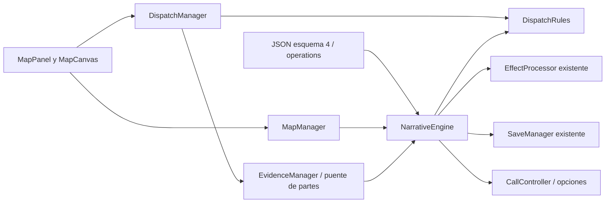

# ÚLTIMA SEÑAL — Mapa operativo y despacho

**11R · 2026-10-29:** inspección oficial contextual con dos accesos, R1 única implícita, confirmación y partes explícitos; plano opcional. Misma autoridad de DispatchManager, comandos y estado. Reubicar requiere confirmación; consultar/cancelar no despacha. Un plan preparado debe corregirse explícitamente antes de cambiarlo. Demos conservan su interfaz de mapa. [Contrato de experiencia](CASE_FLOW_EXPERIENCE.md).

**Revisión UX posterior a 11:** la UI oficial activa DispatchManager.contextual_reports; otros consumidores conservan false y la API estricta. Disponibilidad usa preview_contextual_dispatch y el gesto explícito de recibir parte usa process_contextual_dispatch. Se prepara el contexto mediante opciones sin efectos, en candidato aislado y con una sola publicación; no por cambiar pestaña. Un plan preparado exige corrección explícita. El mapa preselecciona incidente/R1 únicamente cuando son únicos, muestra confirmación/cancelación juntas y partes antes del plano. Elegir ubicación no despacha. [Contrato, límites y verificación](../cases/CASE_001_UX_REVIEW.md).

**Integración 11 · 2026-10-29:** [Caso 001](../cases/CASE_001_IMPLEMENTATION_REPORT.md) usa un distrito, dos accesos al mismo hotel y R1 RESCUE exterior; no bomberos actuales. Extensiones opcionales: layout_kind=building dibuja contorno esquemático; closed_when deriva operaciones cerradas conservando la última posición. No hay enum/inventario paralelo o liberación al finalizar. Reglas from_node/next avanzan a los nodos de parte dentro del candidato atómico. next exige origen válido; sin next, las reglas de 10 conservan su semántica. La fase reposition exige BUSY/ASSIGNED → ASSIGNED/CLOSED del incidente anterior y target_incident_id distinto, conocido/ACTIVE/compatible; asigna el nuevo destino sin disponibilidad intermedia. Son comandos event registrados/reconstruidos por la misma API. Las menciones siguientes a dos tipos, ausencia de reubicación o Caso 001 no integrado describen el alcance original de 10, no el estado actual. Demo y pruebas anteriores conservadas.

PROMPT 10 · 2026-10-28 · Godot 4.7.2 estable / Compatibility. Escenario técnico fuera de campaña. **09B está pospuesto intencionalmente y no bloquea 11.** Este documento no autoriza iniciar 11 o integrar el Caso 001.

## 1. Objetivo y acceso

Consultar ubicaciones conocidas, seleccionar un incidente/unidad y confirmar asignaciones con consecuencias narrativas y persistencia. Tiempo discreto, sin tráfico, GPS, mapas externos o cronómetros. No cambia el diseño de la unidad R1 del Caso 001; la demo tiene su propia patrulla y ambulancia, sin bomberos.

Desde una ejecución nueva: **F5 → Ingresar a la central → Llamadas → Prueba de mapa y despacho → Responder comunicación → Registrar los avisos de prueba → Mapa**. La acción solo aparece en desarrollo y sin sesión activa. Si existe otra demo, volver a ejecutar F5 para elegir esta. Continuar sigue deshabilitado.

Para recuperar al reabrir: preparar Prueba de mapa y despacho → Recuperar prueba, sin Responder de nuevo. Preparar identifica el caso pero no inicia sesión/efectos ni sobrescribe el checkpoint. Reiniciar prueba borra explícitamente solo su ranura técnica y prepara una sesión nueva.

## 2. Arquitectura



DispatchManager es la autoridad de solicitudes de despacho; comparte DispatchRules con el motor para evaluar sin duplicar reglas. NarrativeEngine confirma el candidato completo sobre el estado central y sigue siendo autoridad de historia/condiciones/efectos. MapManager solo proyecta información visible; MapPanel presenta y envía comandos, sin asignar variables o resolver consecuencias por su cuenta.

| Archivo | Responsabilidad |
| --- | --- |
| [map_manager.gd](../../scripts/systems/map_manager.gd) | Mapa, distritos y fichas de ubicaciones/incident_ids conocidos, copias de solo lectura |
| [dispatch_manager.gd](../../scripts/systems/dispatch_manager.gd) | Consultas, compatibilidad, asignaciones, partes autorizados y liberación restringida |
| [dispatch_rules.gd](../../scripts/systems/dispatch_rules.gd) | Evaluación pura, invariantes, operaciones/efectos generados y resultados estructurados |
| [dispatch_catalog_validator.gd](../../scripts/systems/dispatch_catalog_validator.gd) | Estructura, referencias, enums/bindings, estados iniciales y grafo de transiciones permitido |
| [map_panel.gd](../../scripts/ui/map_panel.gd) | Selección, revisión/confirmación/cancelación, partes, avisos/reintento y enlaces de sesión |
| [map_canvas.gd](../../scripts/ui/map_canvas.gd) | Dibujo nativo estático de sectores/calles/muelle y botones de marcador, sin simulación |
| [map_panel.tscn](../../scenes/screens/sections/map_panel.tscn) | Sustituye el placeholder existente, sin otra pantalla principal |
| [dispatch_demo.json](../../data/maps/dispatch_demo.json) | Caso técnico completo: catálogo, condiciones, referencias de estado, efectos y diálogo |

Sin autoloads, otra sesión, otro SaveManager o colecciones operativas paralelas. Los cambios locales de 09A ya existentes al comenzar 10 se conservaron; no se publican aquí.

## 3. Catálogo de mapa y ubicaciones

Esquema narrativo **4** extiende 3 con `operations`, dentro del mismo JSON/fingerprint. Conserva investigation y audio_analysis; este último puede estar vacío, como en la demo. Esquemas 1/2/3 y sus ejemplos siguen admitidos sin migraciones.

operations requiere exactamente map_id, title, districts, locations, units, incidents y event_rules. ID con patrón `[a-z][a-z0-9_]*`, textos no vacíos, propiedades desconocidas rechazadas. Límites de esta versión: seis distritos, 64 ubicaciones, 16 unidades, 64 incidentes y 256 reglas. No se leen rutas externas desde el catálogo.

Distrito: `{id, name, bounds: [x,y,width,height]}`; límites normalizados dentro de 0–1 y dimensiones positivas. Ubicación: `{id, name, district_id, description, position: [x,y], visible_when, information}`. information contiene objetos `{condition, text}`, proyectados solo si la condición vigente se cumple. Las coordenadas son relativas al canvas, sin GPS. Un ID oculto/desconocido devuelve UNAVAILABLE vacío; selección/consulta no aplica efectos.

La demo representa tres sectores de ensayo y tres lugares: instalación, plaza y muelle de práctica. Son una composición ficticia marcada **no canónica**, no la geografía definitiva de Puerto Umbral. El muelle y su incidente permanecen ocultos hasta su comunicación. Los sectores estáticos pueden verse sin revelar el marcador o contenido de esa ubicación.

## 4. Modelo de incidentes

Cada incidente requiere id, title, description, location_id, incident_type, priority, initial_status, status_variable, required_unit_types, unlock_conditions, activate_conditions y dispatch_event. Prioridades LOW/MEDIUM/HIGH; incident_type es un ID de autoría, no una función ejecutable. Ubicación/tipo/evento deben existir.

status_variable enlaza una variable string enum del caso. Estados persistentes: REPORTED, ASSIGNED, RESOLVED, CLOSED. HIDDEN se representa por ausencia de la proyección si falla unlock_conditions o la ubicación está oculta. ACTIVE se deriva de REPORTED + activate_conditions; no se duplica una marca persistente. Esto permite consultar un aviso verificado que ya no admite despacho.

La demo contiene atención sanitaria compatible con ambulancia, aviso de sensor compatible con patrulla y comprobación portuaria inicialmente oculta, también para patrulla. Sus consecuencias no se aplican por abrir fichas. Una condición/referencia inválida impide cargar el caso, no se ignora silenciosamente.

## 5. Modelo de unidades

Unidad: `{unit_id, display_name, unit_type, initial_status, status_variable, assignment_variable}`. Tipos reconocidos: PATROL y AMBULANCE, presentados como patrulla y ambulancia. La demo crea únicamente patrol_01/PATROL_01 y ambulance_01/AMBULANCE_01; no se generan unidades adicionales.

Estados: AVAILABLE, ASSIGNED, BUSY, UNAVAILABLE. assignment_variable es un enum string con vacío y los ID de incidentes del caso. Se exige inicio AVAILABLE/UNAVAILABLE y asignación vacía; no se aceptan asignaciones iniciales precargadas. status_variable/assignment_variable pertenecen a una sola entidad y no pueden compartir bindings.

Todas estas variables viven en NarrativeSessionState.variables, con tipos/valores permitidos declarados. No se guarda otro diccionario de unidades. Los efectos JSON escritos por el autor no pueden modificar bindings operativos: solo la transacción de despacho genera esos set. Las condiciones sí pueden consultarlos.

## 6. Estados y transiciones

| Operación | Incidente antes → después | Unidad antes → después | Asignación |
| --- | --- | --- | --- |
| Confirmar despacho | ACTIVE derivado → ASSIGNED | AVAILABLE → ASSIGNED | Vacío → incidente |
| Parte arrive | ASSIGNED → ASSIGNED | ASSIGNED → BUSY | Conservada |
| Parte resolve | ASSIGNED → RESOLVED o CLOSED | BUSY → BUSY | Conservada |
| Parte release | RESOLVED/CLOSED → mismo estado | BUSY → AVAILABLE | Incidente coincidente → vacío |

No hay transición arbitraria, liberación por cerrar mapa o autoavance por esperar. El caso terminado admite consultas y conserva el último estado registrado; terminar la llamada no libera unidades ni resuelve incidentes automáticamente. MapPanel lo identifica como operaciones cerradas y deshabilita mutaciones.

## 7. Reglas de despacho y confirmación

MapPanel selecciona ubicación → incidente conocido → unidad, y **Revisar asignación** valida sin efectos. La confirmación muestra incidente, ubicación, unidad y que dejará de estar disponible. **Cancelar** no cambia estado. Solo **Confirmar despacho** envía unidad/incidente y revisión capturada al servicio.

Se verifican sesión válida/no terminada, ubicación visible, incidente conocido/ACTIVE, unidad existente/AVAILABLE sin asignación y tipo compatible. Una unidad ya enviada no puede atender otro incidente; un incidente ASSIGNED no acepta otra unidad. Los ID generados `assign_<unit_id>_to_<incident_id>` comparten espacio global único con opciones, deducciones, audio y partes. La misma asignación repetida devuelve ALREADY_PROCESSED sin revisión/eventos/escritura nuevos. La unidad puede reutilizarse después de liberar, para otro incidente; no se reabre el mismo incidente completado.

La evaluación produce efectos de estado y emit_event declarado. El motor aplica todo a un candidato mediante EffectProcessor y exige que el diálogo actual conserve una opción elegible. Error/revisión obsoleta/reentrada rechaza sin estado parcial, evidencia o evento nuevo. UI nunca recibe la lista interna de efectos para ejecutarla.

## 8. Liberación y resolución restringidas

No hay botón genérico «liberar cualquier unidad» o función que acepte libremente un estado final. Los botones procesan un event_id declarado con unidad/incidente y revisión. DispatchManager.release_unit exige además regla de stage release; process_event valida referencias, estado anterior, asignación coincidente y condición vigente.

Cada regla de parte requiere id, label, result_text, stage, unit_id, incident_id, from_unit_status, to_unit_status, from_incident_status, to_incident_status, condition y effects. El validador permite solo las tres transiciones de la tabla. La resolución no libera implícitamente. El mismo resultado/parte repetido devuelve ALREADY_PROCESSED sin ejecutar efectos de nuevo; otro incidente, otra unidad, fase anterior pendiente o regla desconocida se rechazan.

UNAVAILABLE está admitido como estado inicial fuera de servicio; esta fase no crea mantenimiento o cambios arbitrarios de servicio. Añadir esa mecánica exige autorización y un contrato de transición ampliado.

## 9. Consecuencias y tiempo narrativo

Los partes aplican exclusivamente efectos existentes y validados: set/add_clamped de variables narrativas no operativas, add_to_set evidence, mark_once o emit_event autorizado. ConditionEvaluator/EffectProcessor no se duplican o modifican. Los estados operativos generan sus propios set controlados en la misma transacción.

Despachar genera dsp_sent; llegada/resultado/liberación de la demo emiten dsp_update. Son instancias con ID estable por ámbito/índice del efecto y consumo existente del motor. Resultado portuario fija port_done y concede evidencia; la llegada al sensor explica falsa alarma y ocupa el recurso hasta cierre/liberación. No hay penalización arbitraria o pérdida permanente de unidades.

Verificar antes el sensor desde Llamadas deja su aviso comunicado sin despacho y permite reservar patrulla para el muelle. Enviarla sin verificar es legal pero estratégicamente poco útil; el jugador había recibido el indicio de sensor en modo de prueba. La nueva comunicación portuaria demuestra la espera de una liberación narrativa. Las fases avanzan únicamente por acciones explícitas: ningún reloj, tráfico, temporizador de juego, fecha del dispositivo o cambio de pestaña las avanza.

## 10. Integración con llamadas

CallController conserva motor/guardado e incorpora rutas DISPATCH_PATH/DISPATCH_DIRECTORY para la demo. CallsPanel añade un acceso de desarrollo y recuerda caso/ruta al recuperar; no introduce locuciones o nuevas reglas de conversación. DispatchConsole enlaza el MapPanel existente al controlador real, como Audio/Expedientes.

La confirmación cambia estado/condiciones/opciones mediante señales existentes. No cambia current_node, visits o visit_serial ni emite node_changed por despacho: no se repiten entry_effects, elecciones anteriores o mensajes hablados. Abrir Mapa conserva transcripción y llamada. En la demo una asignación habilita comunicar el aviso portuario; el parte de resultado habilita consultar su confirmación. El avance de diálogo sigue requiriendo una elección real.

No se ejecuta otra vez la historia sobre la sesión viva para producir una consecuencia. Se conserva la reconstrucción aislada existente para verificar guardados/proyectar historial; sus efectos no se publican al juego. No se crea un segundo árbol narrativo dentro del mapa.

## 11. Integración con evidencias

Los partes de resultado pasan por EvidenceManager.process_dispatch_event, puente al mismo motor y candidato operativo. La adquisición usa add_to_set del conjunto evidence existente. MapPanel no crea fichas ni concede evidencia por selección. La demo tiene tres fichas de informe declaradas en investigation.evidence, con source estable: atención, sensor y acceso portuario.

EvidenceManager las muestra en Expedientes y pueden ser utilizadas por reglas de DeductionManager sin un inventario paralelo. La demo de 10 no inventa una deducción oficial o modifica el contenido de 08/09A. Un parte oculto/no ejecutado no devuelve la descripción de su evidencia.

## 12. Persistencia y compatibilidad

Esquema narrativo **4** y save_version **4** para casos operativos. Lectores/escritores 1/2/3 conservados, sin migraciones automáticas. Envoltura de ocho campos y snapshot de **17 campos**, sin listas redundantes de despachos/unidades/incidentes. Estados/asignaciones en variables; visibilidad/activación derivadas de condiciones; resultados/consumos/idempotencia en registros existentes.

Cada entrada operativa del transaction_log conserva node_id, choice_id y revision y añade `dispatch`:

```json
{"kind": "assign", "unit_id": "patrol_01", "incident_id": "dsp_alarm"}
```

Para partes, kind es event y exige event_id. No se aceptan otros campos, tipos o comandos. choice_id debe coincidir con la asignación generada o regla realmente ejecutada. Los comprobantes analysis de 09A siguen disponibles desde esquema 3; una entrada no puede ser audio y despacho simultáneamente.

Restaurar valida campos/esquema/caso/fingerprint, referencias, estados/asignaciones y diario mediante una reconstrucción aislada de la misma API. Compara el snapshot completo antes de sustituir memoria. Unidad ocupada sigue ocupada; resuelto/cerrado no se reactiva; partes no se vuelven a emitir a la sesión viva. Referencias/commandos/versiones incoherentes se rechazan conservando sesión y originales, con respaldo compatible conforme a [SAVE_SYSTEM.md](SAVE_SYSTEM.md).

Autoguardado escucha state_changed después del candidato estable; selección/revisión/cancelación/rechazos/repeticiones no escriben. El fallo de E/S conserva memoria y se informa con reintento del mismo gestor. No hay nueva ranura oficial, nube o migración. Demo en **user://dispatch_demo**, separada de producción y demos anteriores; pruebas únicamente **user://save_tests/<único>**. Los límites de 4 MiB/profundidad/2048 operaciones y garantías reales de archivos no cambian.

## 13. Interfaz y selección

Plano estático adaptable con tres sectores, vías simples y muelle, colores del sistema existente y sin recursos externos. Marcadores de mínimo 88×88 unidades lógicas; numeración coincide con la lista alternativa. `!` señala un incidente conocido activo/asignado; selección también indicada en la lista. Consultar ubicación muestra nombre, distrito, descripción, información autorizada y sus incidentes conocidos.

Incidentes/unidades/partes se listan como controles táctiles multilínea, estados y prioridades en español. Confirmación/reintento/partes pueden alcanzarse mediante el scroll de consola; barra inferior fija. No hay zoom, arrastre del mapa o precisión de píxel requerida. Filtros/selecciones/confirmación pendientes son presentación temporal, no progreso persistente. Al sustituir/restaurar/reiniciar sesión se limpian y se desconectan señales anteriores.

## 14. API pública

| Servicio | API / contrato |
| --- | --- |
| NarrativeEngine.load_case(path) | Carga el caso/mapa conocido con todos sus catálogos; no inicia la sesión por sí solo |
| MapManager.new(engine), get_map() | Mapa activo/distritos o vacío; no permite cargar archivos/rutas arbitrarios desde UI |
| get_visible_locations(), get_location(id) | Copias de fichas autorizadas, incident_ids conocidos e indicador derivado de actividad |
| DispatchManager.get_incidents(active_only = false), get_incident(id) | Equivalentes de incidentes activos/estado de despacho, sin detalles ocultos |
| get_units(available_only = false), get_unit_status(id) | Unidades y enlaces actuales; solo lectura |
| can_dispatch(unit_id, incident_id) | Validación pura sin exponer efectos internos |
| dispatch_unit(unit_id, incident_id, revision = -1) | Confirmación nueva o rechazo/idempotencia |
| get_available_events() | Solo partes que actualmente cumplen todas sus condiciones, con revisión |
| process_event(event_id, unit_id, incident_id, revision = -1) | Llegada/resolución/liberación restringidas por regla, sin estados arbitrarios desde UI |
| release_unit(unit_id, incident_id, event_id) | Exige parte stage release; no libera por solo conocer unit_id |
| get_dispatch_state_snapshot() | Copia proyectada de incidentes/unidades y acciones confirmadas; no otra fuente de verdad |
| NarrativeEngine.get_dispatch_catalog() | Copia interna del catálogo validado, no proyección de jugador |
| process_dispatch(command, revision = -1) | Revalida con DispatchRules y confirma candidato completo; puente de servicio/reconstrucción |
| EvidenceManager.process_dispatch_event(engine, command, revision) | Puente estático de parte/evidencia, sin otra colección o suscripción |

Todas las operaciones devuelven `{ok, code, message, data}`. Códigos: VALID, ALREADY_PROCESSED, UNAVAILABLE, LOCKED, INACTIVE, UNIT_BUSY, INCOMPATIBLE, INVALID, INVALID_EVENT, STALE y BUSY. La interfaz recibe mensajes en español, sin consecuencias ocultas. Las señales existentes state_changed/evidence_registered/event_requested/choices_changed actualizan consumidores; no hay necesidad de duplicarlas con otro bus global.

## 15. Errores

Datos o referencias incorrectos impiden cargar un mapa válido encima de la sesión anterior. Despacho inválido/oculto/incompatible/reentrante/obsoleto conserva todo el snapshot. Un parte que no corresponde a la unidad, fase o incidente se rechaza sin liberar otro recurso. Resuelto/cerrado no admite asignaciones nuevas. El final de sesión bloquea todas las mutaciones operativas.

Los diagnósticos estructurados contienen code/message y datos acotados; los errores de guardado siguen los logs de desarrollo existentes. No se cierra el videojuego por un rechazo. Las consultas devuelven copias; no existe una API que entregue directamente los diccionarios de estado para alterarlos. No se promete resistencia a modificar deliberadamente código o archivos locales.

## 16. Pruebas y reproducción

```powershell
$dispatchGodot = 'D:\Descargas\Exe\Godot_v4.7.2-stable_win64.exe\Godot_v4.7.2-stable_win64_console.exe'
& $dispatchGodot --headless --path 'D:\Ultima Señal' --import
& $dispatchGodot --headless --path 'D:\Ultima Señal' --script res://tests/dispatch/test_map_manager.gd
& $dispatchGodot --headless --path 'D:\Ultima Señal' --script res://tests/dispatch/test_dispatch_manager.gd
& $dispatchGodot --headless --path 'D:\Ultima Señal' --script res://tests/dispatch/test_dispatch_integration.gd -- 720x1280
& $dispatchGodot --path 'D:\Ultima Señal' --script res://tests/dispatch/test_dispatch_integration.gd -- 720x1280 'D:/Ultima Señal/docs/validation/prompt_10/720x1280'
```

Repetir bootstrap/navigation/integración en 1080x1920, 1080x2400 y 720x1600, con el directorio correspondiente al capturar. No pedir capturas en headless. Resultados, 25 grupos de aceptación, regresiones y límites en [PROGRESS.md](../PROGRESS.md). El auxiliar tiene un vigilante acotado de 60 segundos para detectar errores de prueba; no es un reloj de juego.

Recorrido de falsa alarma: registrar avisos → Mapa/plaza/sensor/patrulla → revisar/confirmar → Llamadas/registrar aviso portuario → Mapa/recibir llegada → intentar enviar a puerto (UNIT_BUSY) → recuperar si se desea y comprobar BUSY → recibir resultado → finalizar/liberar → enviar al puerto → llegada/resultado/liberación → Expedientes/partes → Llamadas/opción habilitada/cierre. La ambulancia puede atender independientemente el aviso sanitario por el mismo ciclo. La alternativa razonada verifica sensor antes y reserva patrulla para puerto.

Doce estados por resolución, 48 PNG reales: empty, map, location, confirmation, assigned, busy, blocked, restored, resolved, released, evidence y closed. La captura de confirmación muestra el bloque y la advertencia de indisponibilidad antes de ejecutar. Matriz de muestras:

| Estado | 720×1280 | 1080×1920 | 1080×2400 | 720×1600 |
| --- | --- | --- | --- | --- |
| Plano | [PNG](../validation/prompt_10/720x1280/map.png) | [PNG](../validation/prompt_10/1080x1920/map.png) | [PNG](../validation/prompt_10/1080x2400/map.png) | [PNG](../validation/prompt_10/720x1600/map.png) |
| Confirmación | [PNG](../validation/prompt_10/720x1280/confirmation.png) | [PNG](../validation/prompt_10/1080x1920/confirmation.png) | [PNG](../validation/prompt_10/1080x2400/confirmation.png) | [PNG](../validation/prompt_10/720x1600/confirmation.png) |
| Mapa recuperado | [PNG](../validation/prompt_10/720x1280/restored.png) | [PNG](../validation/prompt_10/1080x1920/restored.png) | [PNG](../validation/prompt_10/1080x2400/restored.png) | [PNG](../validation/prompt_10/720x1600/restored.png) |
| Evidencias | [PNG](../validation/prompt_10/720x1280/evidence.png) | [PNG](../validation/prompt_10/1080x1920/evidence.png) | [PNG](../validation/prompt_10/1080x2400/evidence.png) | [PNG](../validation/prompt_10/720x1600/evidence.png) |

## 17. Limitaciones y cierre

Solo Windows/Compatibility y mouse/toque simulado. Pendientes APK/release, Android físico, gestos reales/zonas seguras, lector de pantalla y rendimiento móvil. El plano es esquemático estático y técnico, no mapa definitivo de campaña, simulación, navegación o planificación de rutas.

Cada incidente admite una asignación de una unidad y un ciclo terminado, sin reapertura, múltiples unidades por incidente o reasignación en ruta. Dos tipos iniciales; sin bomberos, IA o vehículos controlables. Ampliar esas políticas exige autorización y validar el contrato. Estados de unidades/incidentes están centralizados, pero la presentación temporal se limpia al restaurar.

Sin Caso 001 oficial, pantalla definitiva de resultados, 09B, voces/TTS/subtítulos, GPS/servicios externos, instalaciones, commits o pushes. **09B pospuesto no bloquea 11. Trabajo detenido; 11 requiere su autorización explícita.**

## 18. Crear nuevos incidentes

Cuando se autorice contenido, partir del esquema 4 de la demo. Declarar sectores/ubicaciones normalizados y sus condiciones; usar solo información visible. Crear incidentes, prioridades, compatibilidad y sus variables enum con bindings exclusivos; declarar sus valores iniciales coherentes y eventos existentes. Los desbloqueos narrativos pueden escribir variables no operativas usadas por condiciones.

Crear reglas arrive/resolve/release con estados de la tabla, unidad/incidente existentes, condiciones y efectos narrativos admitidos. Conceder evidencia solo en el parte apropiado mediante ID de ficha declarada. No escribir estados operativos directamente desde diálogo/UI/efectos authored, no introducir código en JSON y no usar IDs en colisión con acciones generadas u otros sistemas.

Validar el archivo completo con el motor y probar incompatibilidad/ocupación/repeticiones/liberación, rutas alternativas, guardado antes/después de cada parte, referencias incorrectas y recuperación sin efectos vivos. Revalidar capturas/tacto en tamaños pequeños y ampliar presupuestos solo tras medición. Incrementar content_version ante cambios; el fingerprint exige contenido exacto y no proporciona migración. Esta guía no exporta el Caso 001 ni cambia R1: su integración sigue en 11 bajo autorización.
