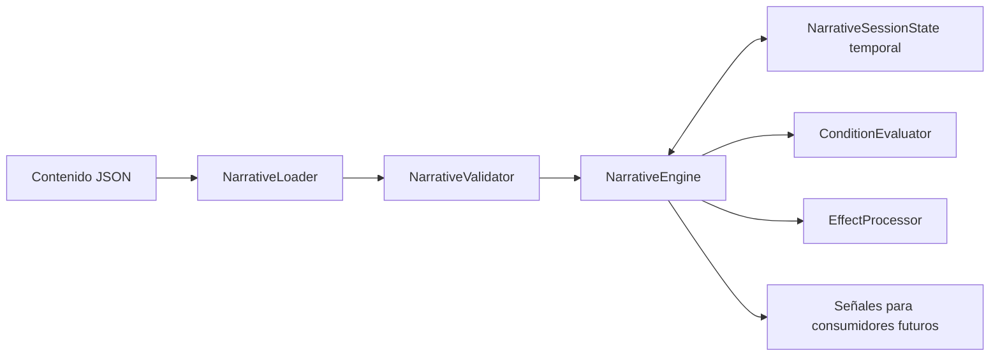

# Motor narrativo de Última Señal

**11R · 2026-10-29:** select_choice_sequence(ids, expected_revision) agrupa de una a cuatro opciones reales sobre candidato aislado, con rollback y una publicación estable. Sus comandos normales quedan en el diario, sin nueva semántica de snapshot o cambios del contenido/fingerprint. No escoge tono, plan o riesgo por orientación. [Contrato y secuencias autorizadas](CASE_FLOW_EXPERIENCE.md).

**Revisión UX posterior a 11:** get_case_id devuelve identidad sin calcular fingerprint. preview_contextual_dispatch consulta el comando sin mutaciones; process_contextual_dispatch prepara from_node solo por opciones elegibles sin efectos y destinos dialogue sin efectos de entrada (búsqueda limitada a 16 nodos). Copia contenido/estado a un candidato, reutiliza select_choice/process_dispatch y publica una sola transacción estable. Fallo revierte también consultas preparatorias; obsolescencia y reentrada rechazadas. El diario usa las opciones y comandos ya admitidos; la reconstrucción estricta no cambia. process_dispatch conserva su contrato directo. Un plan/emoción/evidencia no se atraviesa automáticamente. [Detalle y pruebas](../cases/CASE_001_UX_REVIEW.md).

## Extensiones de integración 11 · 2026-10-29

Caso oficial y verificaciones en [CASE_001_IMPLEMENTATION_REPORT.md](../cases/CASE_001_IMPLEMENTATION_REPORT.md). Los contratos históricos de 05–10 siguientes conservan su versión; este apartado describe las ampliaciones actuales opcionales, compatibles con los casos existentes.

- Diálogos admiten text_variants y text_rows: listas de {condition,text}, validadas con las mismas condiciones. Primera variante coincidente, respaldo text obligatorio y filas verdaderas en orden. get_current_node y reconstrucción del historial utilizan la misma proyección. panel_id opcional solo calls/audio/map/evidence; es presentación, no efectos.
- connection_action opcional referencia una acción real de investigation.actions; internal booleano la oculta de las consultas de Expedientes. CallController la confirma al responder, dentro del diario existente, sin duplicar N01 al restaurar.
- Una regla operativa puede declarar from_node y next; se validan referencias y grafo. La transacción externa aplica efectos operativos y _advance sobre un único candidato, revierte todo si no se alcanza estado estable y publica node_changed solo si avanzó. La reconstrucción agrega la intervención del parte al historial sin reemitir efectos vivos.
- is_investigation_closed consulta fin o closed_when del catálogo operativo. En el caso oficial K02 cierra herramientas antes de que termine la lectura de la rama final; las opciones F siguen siendo narración, sin nuevas adquisiciones.
- Observaciones de modalidad consult aceptan comprobante listened_ms=0 solo si la regla declara ese umbral; replay revalida contexto y condición. Las reglas temporales anteriores no aceptan un cero suficiente.

No hay opcodes de código arbitrario ni lógica de hotel/finales en el motor. Esquemas/formatos 1–4 y snapshot de 17 campos conservados. La versión/fingerprint del contenido exige coincidencia exacta; no se migra contenido anterior automáticamente.

PROMPT 05 · 2026-10-27 · Godot `4.7.2.stable.official.ed1daf0bf` · Esquema canónico 1.

Integración añadida en PROMPT 06 · 2026-10-28: validación e importación transaccional de snapshots para el [sistema de guardado](SAVE_SYSTEM.md). Se conserva el esquema narrativo 1 y la API anterior.

Integración PROMPT 07 · 2026-10-28: [llamadas de desarrollo](CALL_SYSTEM.md) conectadas mediante API. Se añade get_conversation_history sin cambiar esquema o estado persistente.

Integración PROMPT 08 · 2026-10-28: [investigación](INVESTIGATION_SYSTEM.md), esquema 2 con catálogo/acciones/deducciones y confirmación externa atómica. Esquema 1 conserva su contrato; los apartados originales de 05–07 describen esa versión salvo indicación expresa. Guardado 2 solo para casos esquema 2; sin migración automática.

Integración PROMPT 09A · 2026-10-28: [analizador de grabaciones](AUDIO_ANALYZER.md), esquema 3 con audio_analysis y comprobantes mínimos en el diario. Lectores 1/2 conservados, sin migración automática. No se integra audio de llamadas o Caso 001.

El motor interpreta casos JSON, mantiene una sesión temporal y entrega vistas y señales independientes de Godot Control. En 07, Llamadas posee un controlador que lo usa al iniciar o recuperar expresamente una demo de desarrollo; no se inicia narrativa al abrir el menú. [test_narrative.json](../../data/cases/test_narrative.json) conserva la prueba de núcleo y [ui_call_demo.json](../../data/cases/ui_call_demo.json) añade prueba visual fuera de campaña. El Caso 001 sigue siendo documentación de diseño, sin integrar.

## Responsabilidades y archivos



| Archivo en `scripts/narrative/` | Responsabilidad |
| --- | --- |
| `narrative_loader.gd` | Lectura JSON con FileAccess/JSON oficiales y diagnóstico de sintaxis |
| `narrative_validator.gd` | Estructura, tipos, referencias, operaciones y grafo |
| `narrative_session_state.gd` | Valores temporales, cursor, eventos, revisiones y registros de ejecución |
| `condition_evaluator.gd` | Condiciones declarativas previamente validadas |
| `effect_processor.gd` | Efectos sobre un candidato temporal y avisos pendientes |
| `narrative_engine.gd` | API, transacciones, transiciones, finales y señales |
| `narrative_state_validator.gd` | Integración 06: estructura/tipos/límites del snapshot y normalización explícita de enteros JSON |

Todos heredan de RefCounted. No requieren escena, autoload, nodos gráficos ni dependencias externas. El núcleo no contiene rutas del Caso 001, nombres de botones, lógica de hotel o resultados oficiales.

## Esquema canónico 1

Todas las propiedades siguientes son obligatorias. Las propiedades desconocidas se rechazan para detectar errores de autoría; los campos de entrada/condición/efectos opcionales se indican más abajo.

| Propiedad de caso | Forma |
| --- | --- |
| `schema_version` | Entero numérico 1; otra versión o tipo se rechaza |
| `case_id` | ID estable del caso |
| `content_version` | Texto no vacío de versión del contenido, separado del esquema |
| `title` | Texto no vacío |
| `initial_node` | ID de un nodo existente |
| `characters` | Array de objetos `{id, display_name}`; puede estar vacío si no hay diálogos |
| `variables` | Objeto que asocia nombre con declaración de tipo y límites |
| `initial_state` | Objeto `{variables, evidence}` con todos los valores declarados y evidencias iniciales |
| `evidence_catalog` | Array de ID permitidos, sin duplicados; puede estar vacío |
| `event_catalog` | Array de tipos de evento permitidos, sin duplicados; puede estar vacío |
| `endings` | Array no vacío de ID de desenlace permitidos |
| `nodes` | Array no vacío de nodos |

Los ID usan `[a-z][a-z0-9_]*`. Son únicos en su ámbito: nodos en el caso, opciones en todo el caso, personajes y catálogos en su colección. Una `once_key` sí puede compartirse intencionalmente entre fuentes alternativas que deban producir un solo efecto por sesión. Los textos y versiones no están limitados a ese patrón.

### Variables y estado inicial

```json
{
  "variables": {
    "signal": {"type": "int", "min": 0, "max": 2},
    "prepared": {"type": "bool"},
    "mode": {"type": "string", "allowed_values": ["idle", "ready"]}
  },
  "initial_state": {
    "variables": {"signal": 0, "prepared": false, "mode": "idle"},
    "evidence": []
  }
}
```

Este fragmento ilustra declaraciones, no es un caso completo. Los enteros requieren `min` y `max`, ambos enteros finitos y ordenados. Los booleanos solo declaran `type`. Los textos pueden declarar `allowed_values` no vacío y sin duplicados. Las variables no pueden ocupar los nombres de las colecciones especiales.

Godot interpreta los números JSON mediante representación numérica. Para una variable entera se admiten únicamente valores matemáticamente enteros, finitos y con magnitud máxima de **9 007 199 254 740 991**, y se normalizan a int. No se convierten textos ni booleanos en números. `set` respeta los límites; `add_clamped` satura el resultado. Las comparaciones de orden solo aceptan enteros.

## Tipos de nodo

### Dialogue

Campos requeridos: `id`, `type: "dialogue"`, `speaker_id`, `text`, `options`. `speaker_id` referencia characters. Cada diálogo tiene al menos una opción con destino. `entry_effects` es opcional y por defecto vacío.

```json
{
  "id": "demo_start",
  "type": "dialogue",
  "speaker_id": "demo_system",
  "text": "Prueba técnica independiente.",
  "options": [
    {"id": "demo_continue", "text": "Continuar", "next": "demo_end"}
  ]
}
```

### Transition

Campos requeridos: `id`, `type: "transition"`, `next`. Admite `entry_effects`, una `condition` y `fallback_next`, todos opcionales. Sin condición, avanza a next. Con condición verdadera, usa next; si es falsa, usa fallback_next. Si no hay fallback, falla de forma controlada y revierte la operación completa. No existe espera automática de un sistema externo.

```json
{
  "id": "demo_route",
  "type": "transition",
  "condition": {"op": "equals", "target": "prepared", "value": true},
  "next": "demo_success",
  "fallback_next": "demo_partial"
}
```

Las transiciones se resuelven sin interacción y no se presentan como pantallas intermedias. Se admiten como máximo **64 transiciones automáticas consecutivas** por operación. Superar el límite revierte toda esa operación, incluidos sus avisos pendientes.

### Ending

Campos requeridos: `id`, `type: "ending"`, `ending_id` declarado en endings. Admite `text` no vacío y `entry_effects`. Termina la sesión y bloquea nuevas elecciones; no ejecuta guardado ni cambia de pantalla.

```json
{"id": "demo_end", "type": "ending", "ending_id": "demo_done", "text": "Prueba terminada."}
```

## Opciones y disponibilidad

Cada opción requiere `id`, `text` y `next`. Puede declarar `effects`, `visible_when`, `enabled_when` y `disabled_reason`. Sin condición, es visible y habilitada. Si enabled_when es condicional, disabled_reason debe explicar el bloqueo. Una condición `always` permite un motivo vacío, como en el ejemplo aprobado de preproducción.

```json
{
  "id": "demo_confirm",
  "text": "Confirmar preparación",
  "visible_when": {"op": "contains", "target": "evidence", "value": "demo_e01"},
  "enabled_when": {"op": "greater_or_equal", "target": "signal", "value": 1},
  "disabled_reason": "Primero prepare la señal.",
  "effects": [{"op": "set", "target": "prepared", "value": true}],
  "next": "demo_route"
}
```

`get_available_choices()` omite las opciones ocultas y conserva las deshabilitadas con `enabled: false`. Cada elemento contiene id, text, enabled, disabled_reason y revision. El motor vuelve a comprobar pertenencia y condiciones al seleccionar; conocer un ID no permite activar una opción oculta o bloqueada.

Si al entrar en un diálogo no existe ninguna opción visible y habilitada, la operación se rechaza y conserva el último estado estable. Al iniciar una sesión nueva, ese fallo no deja una sesión parcial.

## Condiciones

| Operador | Datos y semántica |
| --- | --- |
| `always` | Solo op; verdadero |
| `equals`, `not_equals` | target de variable y value del tipo declarado |
| `greater_or_equal`, `less_or_equal` | target de variable entera y value entero seguro |
| `at_least`, `at_most` | Alias explícitos de los dos operadores de orden anteriores, conservando los nombres de preproducción |
| `contains`, `not_contains` | target de colección y value con referencia válida |
| `all`, `any` | Array conditions no vacío; AND y OR requeridos por el diseño aprobado |
| `not` | Una subcondición en condition |
| `once_not_applied` | value de opción o once_key declarada; verifica que aún no conste en sus registros |

Ejemplo compuesto:

```json
{"op": "all", "conditions": [
  {"op": "greater_or_equal", "target": "signal", "value": 1},
  {"op": "equals", "target": "prepared", "value": true}
]}
```

Colecciones reconocidas: `evidence`, `events`, `consumed_events`, `executed_actions` y `applied_once_keys`. Evidence usa ID de evidencia; executed_actions usa ID de opción; applied_once_keys usa claves de efectos/mark_once. En events y consumed_events, value es un **tipo de evento del catálogo**: la condición comprueba si existe al menos una instancia emitida o consumida de ese tipo. Consumir una instancia no acredita que todas las instancias del mismo tipo hayan sido consumidas.

No se evalúan expresiones, scripts, nombres de método o rutas procedentes de condiciones. Su profundidad se limita a 32 niveles y se validan todos sus operandos antes de ejecutar el caso.

## Efectos

| Operación | Campos | Resultado |
| --- | --- | --- |
| `set` | target, value | Asigna una variable declarada; `value: true` activa un indicador booleano |
| `add_clamped` | target, value | Suma un entero a una variable entera y satura con sus límites declarados |
| `add_to_set` | target: evidence, value | Registra un ID de evidencia declarado si todavía no existe |
| `mark_once` | value | Registra una clave estable en applied_once_keys sin duplicarla |
| `emit_event` | event_id y payload opcional | Registra una solicitud de evento declarado; payload es un objeto JSON finito |

Todos admiten `once_key` opcional. Los efectos de entrada se declaran en entry_effects; los de una elección, en effects. No hay opcode para ejecutar comandos, abrir archivos, llamar métodos o modificar la interfaz. Agregar una evidencia solo almacena su ID, sin inventario visual o reglas de combinación.

```json
{"op": "emit_event", "event_id": "demo_ready", "payload": {"source": "technical"}, "once_key": "demo_notify_once"}
```

## Transacciones e idempotencia

Una elección se evalúa contra el estado vigente y después se procesa sobre una **copia completa**. En esa copia se registran acción, efectos de elección, entradas y cadena automática. Solo se sustituye el estado real cuando el recorrido llega a un diálogo disponible o un final válido. Después se publican las señales.

Si falla una condición de transición, se alcanza un diálogo sin opciones o se supera el límite automático, se descartan variables, evidencias, eventos, visitas y registros de esa copia. No se emiten notificaciones de evidencias o eventos de una operación rechazada. Sí se emite un error con contexto.

Reglas de ejecución:

1. Consultar nodo, opciones, estado, diagnósticos o eventos pendientes no aplica efectos.
2. Una entrada real incrementa visit_serial y el contador del nodo. Los efectos normales se ejecutan una vez en esa visita, identificados por origen e índice de efecto.
3. Una reentrada legítima crea otra visita y puede repetir efectos ordinarios. Una once_key los limita a una vez por sesión aunque cambie la visita o fuente.
4. Las evidencias tienen semántica de conjunto; redescubrir una no añade otro ID ni otra señal de registro.
5. Todas las opciones elegidas se registran por ID en executed_actions. Un grupo de efectos que deba ejecutarse una sola vez puede proteger su opción con once_not_applied usando el ID de esa misma opción, como requiere la acción de calma del diseño aprobado.
6. `select_choice(id, expected_revision)` rechaza solicitudes de una vista anterior, sin efectos. La interfaz futura debe enviar la revisión recibida para impedir dobles pulsaciones obsoletas. Sin ese argumento, una segunda llamada sobre un bucle que ya creó otra visita representa una nueva acción legítima.
7. Revisiones e ID de instancia de evento son locales a la sesión; se reinician al reiniciar. Una interfaz que reinicie/cambie sesión debe descartar sus opciones y callbacks anteriores, y volver a consultar.
8. Reiniciar reconstruye valores iniciales y limpia evidencias, eventos, consumos, claves, acciones y visitas anteriores. No hay temporizadores ni azar en las reglas.

La misma secuencia de comandos, incluidas las confirmaciones de eventos que se utilicen, bajo el mismo contenido y estado inicial produce el mismo estado. Ningún consumidor externo actúa automáticamente en esta fase.

## Eventos y señales

| Señal | Datos |
| --- | --- |
| `case_loaded` | case_id, después de validar y cargar; aún no hay sesión iniciada |
| `state_changed` | Snapshot completo y separado del estado interno |
| `evidence_registered` | ID recién registrado por un efecto |
| `event_requested` | Objeto `{id, event_id, payload}` de la instancia solicitada |
| `node_changed` | Vista del nodo estable tras resolver las transiciones |
| `choices_changed` | Opciones visibles con disponibilidad y revisión actualizadas |
| `case_finished` | ID del desenlace, una vez al alcanzarlo |
| `narrative_error` | Array de diagnósticos estructurados |

Orden de una operación confirmada: state_changed; avisos nuevos de evidencias/eventos en su orden de ejecución; node_changed si se avanzó; choices_changed; case_finished si corresponde. Consumir un evento actualiza estado/opciones sin volver a emitir node_changed ni case_finished. Las evidencias del estado inicial ya forman parte del snapshot; evidence_registered se reserva a adquisiciones nuevas por efectos.

Las señales entregan copias; modificarlas no altera la sesión. Durante sus callbacks, las API mutables se rechazan con busy, incluida la atención de errores, para evitar operaciones reentrantes o recursión de notificaciones de error. Las consultas siguen disponibles. Un consumidor que necesite actuar debe diferir esa llamada fuera del callback.

Un evento sin consumidor queda pendiente; no se simulan audio, despacho o investigación. `consume_event(instance_id)` confirma una instancia conocida pendiente, no un tipo genérico; repetir la confirmación se rechaza. Puede confirmarse un evento después del final sin reabrir decisiones. Esa confirmación es recepción de una solicitud, no prueba de que un futuro sistema de dominio completó una tarea.

## API pública y ciclo de vida

```gdscript
const Narrative = preload("res://scripts/narrative/narrative_engine.gd")
var narrative = Narrative.new()
```

| Operación | Contrato |
| --- | --- |
| `load_case(path) -> bool` | Lee JSON canónico de res:// y valida. Si falla, conserva contenido y sesión anteriores. Si tiene éxito, sustituye contenido y deja la nueva sesión sin iniciar |
| `start_case() -> bool` | Inicializa una sesión cargada, aplica entradas y resuelve transiciones. No repite un inicio ya realizado |
| `restart_case() -> bool` | Construye otra sesión desde el contenido ya cargado, sin conservar progreso |
| `get_current_node() -> Dictionary` | Vista de id, type, text y revision, más personaje o desenlace cuando corresponda; no expone efectos u opciones ocultas |
| `get_available_choices() -> Array[Dictionary]` | Opciones visibles, habilitadas o bloqueadas; estructuras nuevas |
| `select_choice(id, expected_revision = -1) -> bool` | Revalida, procesa atómicamente y avanza. -1 usa la revisión actual |
| `get_state_snapshot() -> Dictionary` | Copia profunda de todos los datos temporales; vacío antes de iniciar |
| `is_case_finished() -> bool` | Indica si se alcanzó un nodo ending |
| `get_ending_id() -> String` | Desenlace actual, o texto vacío |
| `get_pending_events() -> Array[Dictionary]` | Copias de instancias emitidas aún no consumidas |
| `consume_event(instance_id) -> bool` | Confirma una instancia pendiente de la sesión actual |
| `get_diagnostics() -> Dictionary` | Copia de `{ok, errors, warnings}` de las operaciones de carga/ejecución |
| `get_case_metadata() -> Dictionary` | Copia de ID, versión, esquema y fingerprint SHA-256 del contenido; sin ruta de archivo |
| `is_busy() -> bool` | Consulta del límite de ejecución/notificación para consumidores de persistencia |
| `validate_state_snapshot(snapshot) -> Dictionary` | Validación completa sin modificar sesión/diagnósticos, mediante estructura y reconstrucción aislada del historial |
| `restore_state_snapshot(snapshot) -> bool` | Sustitución completa después de validar; fallo conserva sesión y emite diagnóstico |
| `get_conversation_history() -> Array` | Copias de nodos estables publicados y respuestas confirmadas, en orden; vacío sin sesión. Reutiliza reconstrucción aislada, sin mutar estado/diagnósticos ni emitir eventos vivos |

Solo se permiten rutas de archivo `.json`, con prefijo res:// y ya canónicas. Se rechazan user://, rutas del sistema, barras invertidas o segmentos de navegación. Esta autorización permite leer recursos JSON del proyecto; el efecto narrativo no puede abrir archivos.

Una carga exitosa no ejecuta el nodo inicial. La validación es estructural, no una demostración de todas las condiciones: si el contenido tiene un inicio estructuralmente válido pero bloqueado por su estado inicial, start_case devuelve error sin crear una sesión parcial. Una elección fallida en una sesión activa conserva su último estado completo.

Ejemplo de ruta realmente probada:

```gdscript
if narrative.load_case("res://data/cases/test_narrative.json") and narrative.start_case():
    narrative.select_choice("test_prepare")
    narrative.select_choice("test_continue")
    narrative.select_choice("test_finish")
    print(narrative.get_ending_id())
```

Resultado esperado y comprobado: test_success. Ruta alternativa: test_skip → test_leave → test_finish → test_partial. Ninguna forma parte de Última Señal como historia. El ejemplo de uso no se conecta al juego normal.

## Snapshot y preparación para persistencia

El snapshot contiene schema_version, content_version, case_id, current_node, variables, evidence, events, consumed_events, executed_actions, applied_once_keys, applied_effects, visits, visit_serial, transaction_log, revision, finished y ending_id. Son valores serializables, sin nodos, recursos, métodos ni referencias gráficas. Los datos devueltos no permiten mutar las estructuras internas por referencia.

PROMPT 06 añade importación explícita: se validan tipos, referencias y registros contra una reconstrucción determinista en una instancia sin observadores. Se intercalan consumos según las revisiones de transaction_log; la comparación completa impide restaurar una evidencia, efecto, cursor o final contradictorio. Solo al coincidir se sustituye la sesión viva por una copia, sin volver a entrar en el nodo ni aplicar efectos sobre ella.

La señal nueva session_restored(snapshot) se emite seguida de node_changed y choices_changed. No se emiten state_changed, evidence_registered, event_requested ni case_finished por restaurar. Los eventos pendientes siguen disponibles para consulta y consumo explícito. Las mutaciones reentrantes permanecen bloqueadas.

El núcleo no escribe partidas: SaveManager administra esos archivos según [SAVE_SYSTEM.md](SAVE_SYSTEM.md). No hay migración automática. Límites de importación/guardado: 2048 operaciones confirmadas, JSON de profundidad 32 y 250000 valores, números finitos seguros y, en archivos, 4 MiB. Son límites explícitos, no promesas de rendimiento móvil.

En 07 la misma reconstrucción puede proyectar transcripción: nodos dialogue/ending con texto y elecciones reales, con ID por visita/revisión. Las transiciones automáticas y los consumos de eventos no generan intervenciones. Se conservan las mismas comprobaciones completas de snapshot; no se añade otro historial al archivo ni se cambia save_version. La proyección representa presentación lógica confirmada, no confirmación de lectura humana; el controlador solo permite decisiones de esta demo desde su interacción autorizada.

## Política de errores y límites estáticos

Un diagnóstico contiene source, node_id, property, code y message. JSON mal formado incluye línea y mensaje del parser. Las cargas inválidas no reemplazan una sesión válida. Opciones desconocidas, ocultas, bloqueadas, obsoletas o posteriores al final se rechazan sin cambiar el estado. Los errores de contenido se comunican mediante resultado y señal, sin solicitar el cierre de la aplicación.

El validador comprueba tipos, límites, campos, ID, referencias de personajes, variables, evidencias, eventos, claves y destinos. Busca nodos inalcanzables y rutas estructurales hacia finales. Rechaza ciclos automáticos cerrados sin salida; cadenas con salidas condicionadas también tienen el límite de ejecución para el recorrido que realmente se elija.

Advertencias actuales: nodos inalcanzables y diálogos cuyas salidas son todas condicionales. No se resuelven matemáticamente todas las combinaciones de estado; una salida estructural no garantiza que su condición sea verdadera. Las fixtures de ciclos condicionales y diálogos bloqueados comprueban que esos errores de ejecución se controlen sin corromper la sesión.

## Correspondencia con la especificación del Caso 001

No se modificó [CASE_001_TECHNICAL_SPEC.md](../cases/CASE_001_TECHNICAL_SPEC.md). PROMPT 05 concreta su contrato conceptual y añade estos nombres/versiones explícitos:

- id de caso → case_id; entry_node → initial_node; se añade schema_version separado de content_version. Los ID de nodos/opciones conservan el campo id.
- `evidencias` del diseño corresponde al conjunto evidence del snapshot. En 08 se añade interfaz/combinación genérica con una demo; las fichas y reglas oficiales del Caso 001 siguen sin integrar.
- Se conservan visible_when/enabled_when, set/add_clamped/add_to_set/mark_once y once_key. at_least/at_most tienen alias documentados; all/any/not/always mantienen el significado aprobado.
- El avance enter_node se representa por next y nodos transition; la terminación genérica, por ending con ending_id. No se acepta un efecto arbitrario que cambie cursor o cierre la sesión desde datos sin validar.
- La resolución K02, sus variables de resultado y su presentación posterior en F pertenecen a la integración de 11–12. No se traduce aquí esa lógica ni se cambia qué produce cada resultado.
- Variantes de texto, deducciones, recursos, grabaciones, paneles y mapa de la especificación son contratos de fases posteriores; no se importan como tipos nuevos o simulaciones dentro del núcleo 1. Sus futuras extensiones deben documentarse antes de exportar el contenido oficial a JSON.

Estas son adaptaciones de formato y delimitaciones técnicas del núcleo autorizado; no son cambios narrativos. Los campos u operaciones que no admite el esquema 1 se rechazan expresamente, no se ignoran en silencio.

## Crear otro caso y ejecutar pruebas

Para un nuevo caso técnico, copiar la estructura del ejemplo completo, asignar ID únicos, declarar tipos y catálogos, proporcionar cada valor inicial y terminar las rutas con nodos ending. Asociar las decisiones mediante ID, nunca mediante su texto. Validar y probar el archivo de manera aislada antes de cualquier conexión visual. No crear por esta instrucción el Caso 001 jugable.

En PowerShell:

```powershell
$godotExecutable = 'D:\Descargas\Exe\Godot_v4.7.2-stable_win64.exe\Godot_v4.7.2-stable_win64_console.exe'
& $godotExecutable --headless --path 'D:\Ultima Señal' --import
& $godotExecutable --headless --path 'D:\Ultima Señal' --script res://tests/narrative/test_narrative_engine.gd
& $godotExecutable --headless --path 'D:\Ultima Señal' --script res://tests/narrative/test_narrative_validation.gd
& $godotExecutable --headless --path 'D:\Ultima Señal' --script res://tests/navigation_smoke.gd -- 720x1280
```

Resultados finales reales de esta fase:

| Suite o comprobación | Resultado |
| --- | --- |
| test_narrative_engine | PASS, 151 comprobaciones |
| test_narrative_validation | PASS, 334 comprobaciones |
| Total del núcleo | 485 comprobaciones; salida 0 en ambas suites |
| Importación | Salida 0, sin errores críticos reportados |
| Arranque normal | Salida 0, headless y gráfico |
| Bootstrap y navegación anteriores | PASS en 720 × 1280, 1080 × 1920, 1080 × 2400 y 720 × 1600, headless |
| Regresión gráfica nueva | PASS en 720 × 1280, siete capturas inspeccionadas y 106 nodos descendientes estables |

La suite del motor cubre las pruebas 01–13 y 15–17 del PROMPT 05; la prueba 14 corresponde a los auxiliares existentes y el arranque normal. Además comprueba rollback de evidencias/eventos, revisiones obsoletas, callbacks reentrantes, referencias separadas, consumo de eventos, límites enteros, enum de texto, entrada bloqueada y ausencia de salidas habilitadas.

La suite de validación prueba estructura, referencias, versiones, tipos erróneos, ID duplicados, operadores, profundidad, ciclos y advertencias. Las seis fixtures incluyen datos deliberadamente inválidos o recorridos bloqueados para comprobar sus diagnósticos; no deben tratarse como casos de producción.

Evidencias gráficas de regresión: [Menú](../validation/prompt_05/720x1280/menu.png), [Llamadas](../validation/prompt_05/720x1280/calls.png), [Audio](../validation/prompt_05/720x1280/audio.png), [Mapa](../validation/prompt_05/720x1280/map.png), [Expedientes](../validation/prompt_05/720x1280/evidence.png), [Configuración](../validation/prompt_05/720x1280/settings.png), [Créditos](../validation/prompt_05/720x1280/credits.png). La revisión visual de esta fase es 720 × 1280; las otras tres resoluciones se comprobaron headless y conservan las capturas gráficas históricas de 04.

## Ampliación de investigación en PROMPT 08

El esquema 2 acepta todos los campos de 1 y exige investigation con arrays evidence, deductions y actions. Las fichas cubren exactamente evidence_catalog; categorías e importancia validadas, imágenes opcionales restringidas y fallback textual. Reglas de dos/tres evidencias distintas, conjunto exacto sin orden, condiciones adicionales y efectos existentes; sin repeticiones o reglas ambiguas para el mismo conjunto. Opciones, acciones y deducciones tienen ID globales únicos. Contrato completo y ejemplos de autoría en [INVESTIGATION_SYSTEM.md](INVESTIGATION_SYSTEM.md).

| Nueva API | Resultado |
| --- | --- |
| get_investigation_catalog() -> Dictionary | Copia interna completa con case_id/title; vacío para esquema 1. No usar como proyección de jugador |
| get_investigation_actions() -> Array | Solo disponibles/no ejecutadas en sesión abierta; id/title/enabled/revision |
| process_investigation_action(id, expected_revision = -1) -> Dictionary | Verifica acción declarada y condición actual; confirma una vez |
| confirm_deduction(evidence_ids, expected_revision = -1) -> Dictionary | Evalúa conjunto/condiciones y confirma una conclusión nueva mediante candidato completo |

Respuestas `{ok, code, message, data}`; códigos VALID, ALREADY_DISCOVERED, INSUFFICIENT, LOCKED, INVALID y operativos STALE/BUSY. EvidenceManager y DeductionManager presentan vistas sin pistas ocultas, importancia o efectos arbitrarios. La evaluación preview es pura. Ya confirmada devuelve la conclusión sin nueva revisión o señales; condición pendiente no devuelve metadatos de solución.

La transacción externa conserva cursor/visitas, agrega su ID a executed_actions y `{node_id, choice_id, revision}` al registro, aplica EffectProcessor con ámbito investigation:<id> y verifica que quede al menos una opción elegible. Si falla, revierte variables, evidencia, eventos y todos los registros. Al confirmar incrementa revision, publica state_changed, avisos, **deduction_confirmed(id)** para una conclusión nueva y choices_changed; no publica node_changed ni vuelve a entrar al diálogo.

En esquema 2, choice_id del registro puede ser opción, consulta o deducción. La reconstrucción aislada reconoce los ID por catálogo y reproduce la misma API en orden, con consumos intercalados; compara el snapshot completo antes de importar. La transcripción omite acciones externas: no inventa mensajes ni repite la intervención actual. Las opciones sí reflejan las condiciones actualizadas. Al restaurar no se emite deduction_confirmed, igual que no se emiten nuevos eventos/evidencias.

Los 17 campos de NarrativeSessionState y ConditionEvaluator/EffectProcessor permanecen sin cambios. Las conclusiones se derivan de executed_actions; no hay segunda colección persistente. SaveManager usa formato 2 para esta semántica y conserva formato 1 para esquema 1. Se mantienen los límites de importación, reentradas bloqueadas, referencias exactas y compatibilidad por fingerprint.

## Esquema 3 y observaciones sonoras — PROMPT 09A

El esquema 3 extiende el 2 con audio_analysis: recordings y discovery_rules dentro del JSON exacto del caso. AudioCatalogValidator comprueba metadatos/recursos/intervalos/filtros; NarrativeValidator reutiliza sus validadores de condiciones y referencias. Cada regla tiene ID global único y evidencia existente; no admite efectos arbitrarios. Condiciones/evaluador/procesador y los 17 campos de NarrativeSessionState permanecen intactos.

Nuevas API internas: get_audio_catalog devuelve una copia completa para servicios; register_audio_observation(rule_id, proof, expected_revision = -1) valida desbloqueo actual, condición adicional, regla/contexto y umbral de examen. AudioAnalysisManager es la API de jugador: solo ofrece recursos desbloqueados y genera proof después de escuchar el avance del reproductor, sin aceptar segundos o ID de evidencia desde UI. EvidenceManager.discover_from_audio enlaza esa confirmación con el motor.

Proof contiene exactamente recording_id, segment_id, filter_id y listened_ms entero. Solo una transacción de audio del esquema 3 añade analysis al registro existente; choice_id identifica la regla. Se deriva add_to_set de la evidencia y el evento opcional declarado, y se reutiliza el candidato atómico de 08. Un rechazo conserva estado; una confirmación emite las señales existentes y actualiza opciones, sin nueva visita/node_changed o mensaje hablado. Repetida devuelve ALREADY_DISCOVERED sin efectos nuevos.

La reconstrucción aislada reconoce reglas sonoras, revalida proof/condiciones/umbrales y reconstruye esas acciones con los consumos intercalados. No acepta analysis en entradas de diálogo/consulta/deducción ni en esquemas anteriores. Normaliza listened_ms solo después de validar integralidad/tipo/rango. Restaurar no emite nuevos descubrimientos/eventos o escribe archivos. La partida sigue teniendo 17 campos; formato 3 declara la semántica ampliada del diario. Contrato completo y límites en [AUDIO_ANALYZER.md](AUDIO_ANALYZER.md).

## Esquema 4 y operaciones — PROMPT 10

Esquema 4 extiende 3 con operations: map_id/title/districts/locations/units/incidents/event_rules. La validación sonora de 3 sigue disponible; la demo operativa usa audio_analysis vacío. DispatchCatalogValidator valida catálogo, estados iniciales/bindings y grafo permitido. NarrativeValidator reutiliza condiciones/referencias/efectos y registra los ID de asignación generados y partes en el espacio global de acciones.

get_dispatch_catalog devuelve una copia interna. process_dispatch(command, expected_revision = -1) evalúa mediante DispatchRules y confirma con el candidato externo de 08; no crea otra sesión o procesador. Los estados/asignaciones operativos son variables enum centrales enlazadas por catálogo; se rechazan efectos authored que intenten escribir esos bindings. Solo la operación válida genera sus efectos de unidad/incidente, junto con las consecuencias narrativas/evidencias del parte. Rechazos preservan todo el estado.

En esquema 4, una transacción operativa añade dispatch al registro de tres campos. El comando es assign con unit_id/incident_id, o event con event_id adicional. choice_id debe coincidir con la acción/regla que realmente confirma; no se permiten comprobantes de audio/dispatch en la misma entrada. La reconstrucción aislada usa process_dispatch para revalidar orden, revisión/nodo, disponibilidad, compatibilidad y partes. No publica efectos vivos ni inventa líneas de conversación; no reentra al nodo al despachar. Las 17 propiedades de sesión y ConditionEvaluator/EffectProcessor permanecen sin cambios. Formato 4 declara la semántica ampliada; 1/2/3 conservados. Contrato completo en [MAP_DISPATCH_SYSTEM.md](MAP_DISPATCH_SYSTEM.md).

## Limitaciones e integraciones posteriores

El guardado existe desde 06. 07 añade conversación, 08 expediente/deducciones, 09A grabaciones y 10 mapa/despacho genéricos con demos aisladas. No hay locuciones/subtítulos, servicios externos o Caso 001 jugable. F5 conserva el menú de 04 y no inicia una sesión por sí solo.

09B está pospuesto intencionalmente y no bloquea 11. 11–12 integrarán/comprobarán el caso y sus resultados únicamente bajo autorización; no se inician por esta documentación.

No se exportó APK ni se probó Android físico. La evidencia de 05 conserva su alcance histórico; ensayos posteriores en [PROGRESS.md](../PROGRESS.md). **PROMPT 10 cerrado; no iniciar 11. 09B sigue pospuesto.**
